<div align="center">



### *"This… is the Construct. Our loading program. We can load anything."*

**A disposable Ubuntu VM for unattended AI coding agents.**
Claude Code, Codex and Opencode run as root in bypass mode inside a VM.
They cannot touch your PC.

[](LICENSE.md)

</div>

---

## What it is

| Part | Where | What it does |
|---|---|---|
| Engine (`constructd`) | [`service/`](service/README.md) | Runs on the machine that hosts the VMs: your own Windows PC with Hyper-V, a shared Hyper-V host or a Proxmox VE node. Creates, provisions, reinstalls, backs up and updates VMs as jobs, and keeps the users' records. |
| Device agent | [`agent/`](agent/README.md) | Runs on every PC you work from (Windows tray app, Linux user service). Holds your keys, talks to your engines, keeps port forwards, notifications and the microphone link to your VMs, and serves the UI. |
| UI | [`ui/`](ui/README.md) | One web app for the agent's tray pop-out and window, a browser or phone, and VS Code. |
| VS Code extension | [`extension/`](extension/README.md) | A window onto the device agent inside VS Code, plus the Remote-SSH link to your VMs. |
| Guest | `bin/`, `config/`, `systemd/`, `projects/` | What a VM is provisioned with: the agents, T3 Code, VS Code server, the `construct` CLI and your project profiles. |

## ⚡ Install

On Windows, open PowerShell and paste:

```powershell
irm https://raw.githubusercontent.com/permissionBRICK/The-Construct/main/install.ps1 | iex
```

It installs the device agent for your user and opens its window, which sets up the engine and your
first VM. An existing install of the old client moves over in the same window. On Linux,
`agent/install/install-construct-agent.sh` installs the agent for your user ([agent/README.md](agent/README.md)).

## 📚 Documentation

| Guide | What's inside |
|-------|---------------|
| [Release flow and channels](docs/release-flow.md) | Stable and nightly, release cuts, the channel manifests |
| [Local checks](docs/local-checks.md) | The test groups and when to run them |
| [Project profiles & configuration](docs/projects.md) | `config.env`, the profile schema, MCP servers, checkouts |
| [Config sync](docs/config-sync.md) | How project profiles reach the VMs and come back |
| [Remote access & services](docs/remote-access.md) | serve-web, tunnels, Codex remote, T3 Code, services in the VM |
| [`construct expose`](docs/expose.md) and [HTTPS forwards](docs/https-forwards.md) | Port forwards from the VM to your PC or the host |
| [Child VMs](docs/child-vms.md) | `construct vm`: create, run, share and remove test VMs |
| [Key vault](docs/key-vault.md) | Secrets agents use only with your approval |
| [Backup & restore](docs/backup-restore.md) | Agent configuration and auth across reinstalls |
| [Proxmox host](docs/proxmox-host.md) | The engine on a Proxmox VE node |
| [Manual setup](docs/manual-setup.md) | From a blank Ubuntu VM to a ready one by hand |
| [XFS & worktrees](docs/worktrees.md) | Why guests use XFS, and how new git worktrees get reflinked build outputs |
| [Design](docs/plans/construct-platform-design.md) | The platform's design and the decisions behind it |

## 📄 License

[MIT](LICENSE.md) © permissionBRICK
