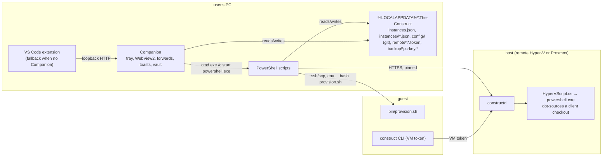
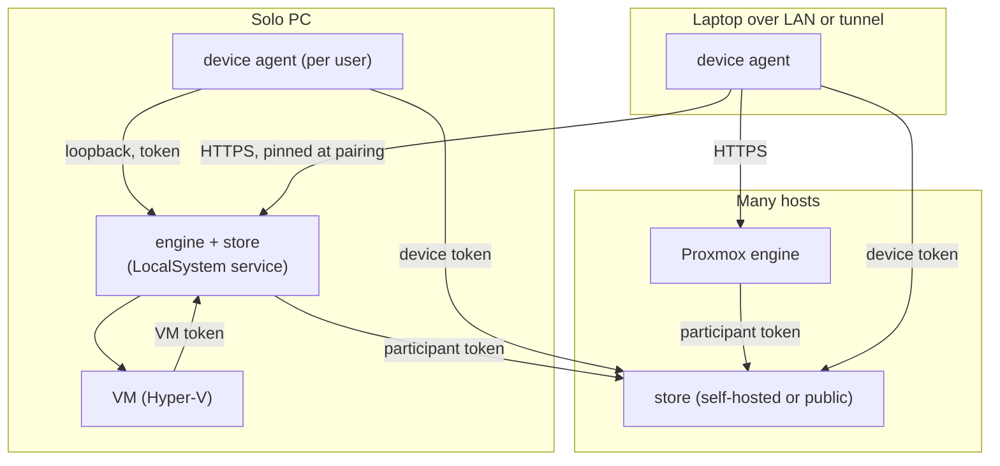

# The Construct platform: client-side refactor (phase 0 design)

Status: phase-0 design, revision 11, 2026-11-09. Factual claims were verified against the
repository at commit `d399476`. Nothing in this document is implemented. It replaces the
client-side parts of [modular-remote-architecture.md](modular-remote-architecture.md) and the
Companion decisions named in section 3; the guest contract and the host service stay in force.
Revision 6 folds in the owner's decisions from the plan walkthrough of 2026-11-09 (S9 to S15 in
section 3): one rework branch merged in one go, hosts as the only mergers, per-field profile
merges, a required recovery code, the supported upgrade set, test VMs created on demand with a
test cadence, the store as a container and install statistics. Revision 7 settles four of
its questions (S16 to S18) and adds two later work packages the owner asked for: host setup media
and Proxmox clusters (section 18). Revision 8 settles the remaining questions of section 17 (S19 to S23 and the table there).
Revision 9 answers the fourth independent review, which read revision 8, and revision 10 answers
its re-check (Appendix B). Revision 11 is a simplification pass the owner asked for (S24): eight mechanisms replaced by
simpler ones, with the remaining risk named. It answers the two findings left open by the re-check
of revision 10 that way. Revision 11 has not been reviewed;
revisions 1 to 3 were, and revision 4 answers the third review. Revision 5 folded
in the owner's first page comments (tool-set changes with opencode 2, the help assistant, the T3
coupling overhaul, and the resume helper retired because T3 continues interrupted runs itself).
Appendix B logs every review finding and what revision 6 supersedes; Appendix C holds the
protocol requirements by phase.

## 0. How to read this document

| Marker | Meaning |
|---|---|
| SETTLED | Decided by the project owner. Not reopened here; risks are flagged, not argued. |
| PROPOSED | This document's design, open to improvement until accepted. |
| REQUIRED (phase N) | A property the named phase must deliver and prove by named tests. Details in Appendix C. |
| OPEN | A question the owner answers before the phase that needs it (section 17, with recommended answers). |

## 1. Goals and what this design does for each

| Goal (owner) | What this design does |
|---|---|
| One coherent, modular client platform | One engine (`constructd`) runs every lifecycle operation as a job; one typed API; one device agent; one UI. PowerShell survives only inside the Hyper-V driver and the shims T3 Desktop calls. |
| Business logic multi-platform and reusable | Engine and device agent are .NET; platform code sits behind interfaces that exist in `companion/src/Construct.Companion.Core/Abstractions` and `service/src/Constructd.Core/Abstractions`. Linux gets the client app with the merge, the Mac after it (phase 5); a local VM on a Mac needs a driver this design does not plan. |
| Out of the box; one-click update of the whole chain | One manifest per channel; every module updates itself and one button asks them all (section 12). The first click from today's installs goes through the upgrade hook (13.2) and the one-time upgrade dialog (11.6). |
| Staging before stable | A nightly channel every change lands on first, a stable channel fed only by release PRs, agent-assisted selective promotion (section 12A). |
| Agents manage the system; deliberate guardrails only | Policy matrix for VM tokens (section 10): vault approvals, backups the VM cannot destroy, device-only operations. |
| Many clients, VMs and hosts | Per-device keys, pairing approved by a device, encrypted records with compare-and-swap revisions (sections 8, 9). |
| One UI, no native dialogs, one pending element | The UI is an API client; prompts are job questions; the engine computes pending changes (7.5, 11). |
| Failures confined to their operation | Read endpoints never fail because of an unrelated subsystem (6.3). |
| Testable at every layer, by change area | Section 14: checks selected by change area, end-to-end runs on test VMs created on demand, a scheduled nightly run. |
| Know how many installs exist, without personal data | Anonymous install statistics from hosts (5.5). |
| A host that is easy to set up, and hosts that form a cluster | Later work: host setup media and Proxmox clusters (section 18). |

## 2. Today's system, verified

### 2.1 Components and sizes

| Component | Size | Notes |
|---|---|---|
| Client PowerShell | About 27.6k lines across the root `*.ps1`, `lib/`, `drivers/` | `Auto-Install.ps1` 4,507; `Provision-AgentVM.ps1` 4,059; `lib/AgentVm.Common.ps1` 7,347 (config sync about 3,450 from `:3089`). All `#Requires -Version 5.1`; all launchers run `powershell.exe`. |
| Companion (`companion/`) | 16.0k lines C# in `src/`, 8.3k tests, .NET 10 | Core has no package references; `Construct.Companion.Windows` is 277 lines. |
| VS Code extension | `extension.js` 6,089; `src/*.js`; `media/*.js` shared pages | `media/panel.js` 1,468, `hostadmin.js` 1,005, `vault.js` 381. |
| `constructd` (`service/`) | 39.1k lines `src/`, 28.0k tests, .NET 10 | 143 routes under `/api/v1`. |
| Guest | `bin/provision.sh` 1,585; `bin/construct` 347; helpers | Only invoker of `provision.sh`: `Provision-AgentVM.ps1:3173` (`:1514` second phase). |
| Parity fixtures | 5.9 MB, 40 files, `test/fixtures/companion-parity/` | From `extension/test/export-parity-fixtures.js`. |
| Release workflows | `host-release.yml`, `companion-release.yml` | Trigger on pushes to `main` only; builds report `1.0.0+<sha>` (`host-release.yml:22-25`); assets under tag `host-<sha>`, manifest at `releases/latest`. |

### 2.2 The same logic three times

| Logic | PowerShell | JavaScript | C# |
|---|---|---|---|
| Instance registry and per-instance state | `lib/AgentVm.Instances.ps1` (1,772), `InstanceState.ps1` | `extension/src/instances.js` (2,054) | `Core/State/InstanceRegistry.cs`, `InstanceStateStore.cs` |
| Config sync | `lib/AgentVm.Common.ps1:3089` onward, with a `JSON.stringify`-matching serializer (`:4098`) | `extension/src/configsync.js` (2,101) | `Core/ConfigSync/*`, `Host/ConfigSync/*` |
| `constructd` client, TLS pin, DPAPI tokens | `lib/AgentVm.Remote.ps1` (1,407) | `extension/src/remotehost.js` (865) | `Core/Remote/RemoteHostRoutes.cs` (90 `JsonNode` methods) |
| SSH args, VM power probes, manifest checks, lifecycle marker, argv builders | yes | yes | yes |

Alignment is kept by golden fixtures and by regex-scanning PowerShell sources for supported
parameters (`LifecycleBuilder.cs:136`, `extension/src/lifecycle.js:890`); PowerShell probes its
neighbours on about 48 lines.

### 2.3 Control flow today



Facts the design depends on:

- VM create job: network, ISO or cloud-init seed, create, wait reachable, detach, memory floor,
  SSH forward, VM token (`Jobs/VmJobs.cs:18-129`). Provisioning is the client's job over SSH.
- The Hyper-V driver dot-sources a client checkout (`HyperVScript.cs:141-165`); startup needs it
  (`ServiceComposition.cs:348-367`). Off Windows and off Proxmox the service needs `--fake`
  (`ServiceComposition.cs:236-243`); there is no Linux driver.
- The job engine persists every snapshot and progress line (`InProcessJobEngine.cs:352`) and
  fails running jobs at startup (`Bootstrap.cs:24-32`), except host updates and child operations.
- Secrets reach the guest in the `env` prefix (31 to 37 variables, `Provision-AgentVM.ps1:3140`)
  and on stdin (`:3128-3139`, `:3280`).
- The guest records `CONSTRUCT_COMMIT` in `/etc/construct/provisioned.env` (`provision.sh:1555`
  onward); clients compare it with `installedCommit` (`UpdatePlanner.cs:19`).
- Updater `Update-Construct.ps1`: downloads, dot-sources the **downloaded** `lib\AgentVm.Common.ps1`
  (`:78`), calls `Install-ControlPanelExtension` (`:94-99`, failure fails the update),
  `Set-ConstructInstalledMarker` (`:105`, exception fails the update) and
  `Invoke-ConstructCompanionInstallHook` (`:111-112`, failures swallowed); reports `ok`/`fail`
  through a result file (`:121-123`); runs non-elevated from Companion (`MessageDispatcher.cs:353`),
  extension (`extension.js:2684`) and T3 Desktop. All 14 historical bodies dot-source the
  downloaded lib and call the downloaded marker function; only `5db7981` takes the lifecycle lock,
  only five bodies have the Companion hook, and two bodies (`68d9560`, `1a9346b`) contain an
  em-dash inside a `Write-Host` string that WinPS 5.1 cannot parse (fixed by `c05ed84`), so they
  never run at all (section 13.2 has the classes).
- Channel plumbing today: the PC stores `constructRef` in `.construct-settings.json`
  (`lib/AgentVm.Common.ps1:3029`); `install.ps1:21-22` and `Update-Construct.ps1:38-39` put the
  ref into the install folder name; the host config `updates.channel` is validated to `main` only
  and never selects anything (`HostConfigValidation.cs:49`, `SourceCache.cs:58`); a raw search for
  `refs/heads/main` or `releases/latest` hits 39 lines in 24 non-test files, of which about 23 in
  17 files resolve the Construct release itself (section 12A.5 classifies them).

### 2.4 Facts that change the design

1. The guest can label any backup `pre-reinstall`, which pins it 14 days (`BackupUpload.cs:71`,
   `BackupRotation.cs:37`). New-session limits are host free space plus an optional per-VM quota
   (`BackupEndpoints.cs:100-120`, `BackupCoordinator.cs:74`); one open session per VM, no
   priority between slot and scheduled uploads. Rotation accepts `keep = 1` (`BackupRotation.cs:36`)
   and its calendar slots can coincide with the newest (`:39`).
2. `t3 thread start <project> <message>` exists in the installed CLI (`t3 v0.1.7`).
   `bin/construct-t3-resume.py` speaks only the HTTP orchestration API that v2 servers dropped,
   so it skips on every current T3. T3 itself continues a run that a server restart cut off
   (`continueThreadsAfterServerUpdate`, default on, present in `t3 v0.1.7`).
3. A new PC cannot open backups made before its key was enrolled (`construct-backup.sh:466-478`);
   every new backup wraps to every enrolled recipient, and `recipients remove FINGERPRINT` exists
   (`:93`).
4. Companion D10 ("no admin at any point") conflicts with S4; `Auto-Install.ps1:1087` already elevates.
5. Both host updaters keep a `previous-install.json` ledger, roll back files, and in `database`
   mode restore the SQLite file from the pre-update copy (`update-construct-host.sh:219-232`,
   `Update-ConstructHost.ps1:160`, `:225-250`).
6. Per-instance client state lives in `instances\<name>.json` (`InstanceStateStore.cs:13`); the
   vault document holds leases with `usesLeft`, cleanups, tombstones and per-host settings
   (`VaultStore.cs:50-75`); an expired lease is ended through `End`, which queues a scrub of the
   released value (`VaultService.cs:423`).
7. Hosted vault unlock keeps `K` in RAM for a running VM and drops it when the VM stops
   (`VaultHostService.cs:58-80`); nothing depends on a device connection.
8. Primaries have a nested-virtualization setting (`PrimaryNestedEndpoints.cs`, `IVmNestedDriver`
   on the Proxmox driver, capability `primary-nested`); children have none (`bin/construct-vm.sh`),
   so a Windows child cannot run Hyper-V today. `test/proxmox-nested-installer.test.sh` evaluates
   one shell function.
9. The development VM has 9.6 GB RAM, about 5.5 GB available during a session, and `/dev/kvm`.
10. The Companion exposes `POST /v1/quit {reason: update}` (`IpcServer.cs:127`), usable as a
    fence by the upgrade hook.
11. Known installs (owner, 2026-11-09): fewer than ten, solo PCs and shared hosts, all expected
    to run a release from 2026-09-11 or later.
12. Hosts keep token usage per VM, day and tool: input, output, cache and total tokens
    (`TokenUsageEndpoints.cs:60-67`).
13. The vault document sits under user-scope DPAPI (`DpapiProtection.cs:12`). A vault that Windows
    can no longer unprotect is marked unavailable (`VaultService.cs:37`); the user can then only
    reset it, after a confirmation, which moves the file aside and starts an empty vault
    (`VaultService.cs:374`, `VaultView.cs:197`). The
    key can be exported for a second PC (`VaultHosts.cs:492`), but no flow asks the user to keep
    a recovery copy.

## 3. Settled decisions

SETTLED (owner, 2026-11-09; S9 to S24 from the plan walkthrough the same day), with risk notes.

| # | Decision | Risk notes |
|---|---|---|
| S1 | .NET for engine and device agent. | None. |
| S2 | Provisioning may run from the host; secrets in host RAM for the run only. | Released secrets are visible to the host administrator and host diagnostics; section 7.4 states the boundary. |
| S3 | The extension becomes a thin client; the in-process fallback goes (supersedes Companion D2, D8, D9). | The extension must still install and start the device agent. |
| S4 | A solo install runs the host service; the hostless path goes. | The engine is essential for local use; the agent's repair CLI must work without the engine API (REQUIRED, phase 1b). |
| S5 | Store: by default the host's service; separately hostable; data arrives encrypted. | Default store shares the host's failure domain; recovery needs keys, store database and backup payloads (8.5). |
| S6 | Auth stays pluggable. | None. |
| S7 | Conflicts resolved inside a VM by an agent; headless and UI fallbacks. | Schema validity is not semantic safety; 10.4 is the control. |
| S8 | VM-triggered backups get one slot; rotation slots are host-authorized. | A host's request proves authorization, not clean content; retention protects only within the declared horizon (10.2). |
| S9 | Engines are the only mergers. Devices hold the keys, read through an engine and write their own record kinds online (9.1, 9.2). | A device cannot edit while its store is unreachable. |
| S10 | Profiles merge per field (9.6). | When two sides append to `provisionCommands`, both sets are kept in a fixed order; nobody checks that the combined order makes sense. |
| S11 | The recovery code is a required step of the first run and of the upgrade, and restores everything under `U`, the vault included (8.5, 11.6). | The code restores keys, not data; a lost store disk still needs the export or a store on another machine (8.5). |
| S12 | One-click upgrade is supported from releases with the Companion hook (updater classes E and F); older installs use the one-line reinstall (13.2). | An unknown install that is older gets a failing update button until its user reads the release note. |
| S13 | The rework is built on one branch, tested on installs moved over by hand, and merged into `main` in one go (15). | A long-lived branch drifts from `main`; one release carries every change at once. |
| S14 | End-to-end tests run on VMs created on demand on the host. Full runs happen at night and before a stable release; during development the Windows VM runs only when Windows-specific code changed (12A.4, 14). | A regression in an expensive lane is found the next morning, not at the PR. |
| S15 | The store also ships as a container; a public instance may follow as a closed, possibly paid service (5.4). Hosts report install statistics: install count, versions, token totals, nothing personal (5.5). | A public service first needs the integrity and rotation work deferred in 17.5 and S16. |
| S16 | The first release revokes a device or host by deleting its tokens and does not re-key. Key rotation is built together with the public store (8.4). | A revoked party that still holds the keys can read later ciphertext if it gets at a store's disk or a backup file. |
| S17 | Install statistics are on by default, shown in the setup dialog with their exact content and one switch (5.5). | None. |
| S18 | The Linux device agent is part of the merge; the macOS agent follows it (15). | A Linux PC is a client of a host elsewhere until the QEMU driver exists (phase 6). |
| S19 | The review hold for profile changes written by a VM is not built for the first release (10.4). | A compromised VM can still change a profile that other VMs provision from, as today. |
| S20 | Every module updates by itself under its own stored policy: device agent, engine and T3 Desktop. A VM's guest payload updates through its engine, which is there whenever the VM runs. No update needs a device or a VM to be present (12.1). | Modules run different versions for a while; `apiFeatures` and the skew window cover that (6.1, 12.2). |
| S21 | An agent can ask the user to enter a secret: it files a request under a name and the user pastes the value into a dialog on a device (10.3). | The VM that asked gets the value only through a later approved lease, like any secret. |
| S22 | opencode 2 ships on `main` now, as its own release ahead of the rework (4.2). | None for the rework: its comparison (13.3) is made afterwards. |
| S23 | Proxmox clusters get one engine per cluster; the investigation settles the details (18.2). | See 18.2. |
| S24 | Simplicity over machinery. Where a rare failure can be handled by a retry or by hand, the design names the risk and adds no mechanism. Applied in revision 11 to the host update, the one-time upgrade, job recovery, backup requests, guest changes, the store, version skew and manifest signing (Appendix B). | An upgrade or job that fails halfway needs a retry or help by hand; a host update never rolls its database back by itself; manifests are not signed until the public service exists. |

## 4. Compatibility invariants

SETTLED, with the owner's clarification that guest adjustments are allowed when the installed
tool and tweak set stays the same. Revision 11 drops the two classes of guest change with their
own release rules: one branch and one merge left them without a purpose.

| Invariant | Wording |
|---|---|
| Project profile format | Unchanged; additive optional fields only (`projects/project.schema.json`). |
| Guest equivalence | Provisioning moves into the engine with the same guest result as the last PowerShell-provisioned release, shown once by the comparison of 13.3 before the engine path replaces the PowerShell one. |
| Guest changes afterwards | Ordinary PRs. The `provision.sh` env-in, sentinel-out contract stays (`bin/provision.sh:96-110`, `:159-167`, `:302-333`). The nightly end-to-end run prints the guest manifest diff against the previous night, so a change in installed tools or files is seen the next morning (12A.4). |
| One-click upgrade of existing clients | From releases with the Companion hook (S12): the shipped updater's hook installs and starts the agent, whose upgrade dialog converts (13.2). Older installs use the one-line reinstall. |
| Backups stay restorable | Every backup from any released version restores on the new stack. |
| External dependents | T3 Desktop's script names, `ConstructCompanion.exe --panel|--settings` and the in-VM `/run/construct/vault-pending/*.json` keep working until the minimum supported T3 build speaks the device agent's API (11.4); then they retire with the old routes (phase 6). |

### 4.1 Guest changes this design makes

An inventory, not a permission list.

| Change | Section | Phase | Why the tool set is unchanged |
|---|---|---|---|
| `bin/lib/construct-api.sh` replacing six copies of `cfg_resolve` | 6.1 | 2b | Refactor of existing helpers; same commands and exit codes |
| `construct project set|delete` posts to the engine when a service URL is set; file and marker fallback | 9.3 | 3a | Same command, same files, one HTTPS call |
| Heartbeat: projects digest in the request; `conflicts` in the reply | 9.3 | 3b | Optional fields in an existing script |
| `construct project conflicts|resolve` and the prompt file in `config/` | 9.6 | 3b | New subcommands, no package |
| `construct manifest` | 13.3 | 2b (before that, the rig runs the manifest script from the test tree over SSH without installing it) | Read-only reporting |
| `provisioned.env` gains `CONSTRUCT_PAYLOAD_HASH`, `CONSTRUCT_DESIRED_HASH`, `CONSTRUCT_CHANNEL` | 7.5, 12A | 2b | Marker keys beside `CONSTRUCT_COMMIT` |
| `construct-t3-resume.py` and its unit retire. T3 continues a run cut off by a server restart itself (`continueThreadsAfterServerUpdate`, default on, about 3 s after the server is back, at most 3 continuations per chain), and the helper speaks only the removed v1 HTTP API, so it already does nothing on current T3. The helper also mints the T3 API token `/etc/construct/t3-resume-token`, which the T3 registration check reads (`bin/install-ai-tools.sh:939`); that minting moves into the installer. Two differences from the helper are accepted or checked: T3 does not message a thread that was idle with background watchers, and T3 resumes when its server is back, which today is in the middle of a run, so the barrier the helper had moves into provisioning (see below the table) | 9.6 | 3b | Removal of a helper that no longer acts; the resume behaviour comes from T3 |
| Help prompt file in `config/` for the help assistant | 11.5 | 4 | New prompt file, no package; uses the installed `t3` CLI |
| `construct secret ask <name>`: files a request for a secret the user then enters on a device (working name) | 10.3 | 3b | New subcommand of the existing `construct secret` CLI, no package |

T3 barrier (REQUIRED, phase 3b), replacing the resume helper's wait for the end of provisioning.
Today T3 comes back in the middle of a run: the installer restarts it (`bin/install-ai-tools.sh:1246`)
before the project commands (`bin/provision.sh:1493`), and a restore starts it on the restored
thread database (`bin/restore-config.sh:208`) before the deferred project commands
(`bin/provision.sh:295`). T3 would continue interrupted threads at either point.

| Element | Rule |
|---|---|
| Span | From the first point at which a run stops T3, for a new build or for a restore, T3 stays stopped until the run's finish step. That covers install, restore and the deferred project commands. |
| Start | The finish step starts T3, on success and on failure. When a reboot follows (`bin/provision.sh:147`), it leaves T3 enabled and stopped, and the boot starts it. |
| Work that needs a live server | Project registration and the running-build check move behind that start: into the finish step, or into a one-shot unit after boot when a reboot follows. |
| Unchanged build, no restore | T3 is not stopped at all and threads keep running, as today. |
| Cost | The T3 UI is unavailable for the rest of a run that had to stop it. |
| Tests | On the rig: an ordinary reprovision, a reinstall with restored interrupted threads, and a failing run, each with a deliberately long project command; no continuation starts before the sentinel, and T3 is up afterwards. |

### 4.2 Tool-set changes

A change to the installed tool or tweak set is an ordinary PR, labelled so the release notes name
it. Existing VMs get it as a `reprovision` entry in the pending element (7.5, 12.1), with a note
for any state, config or session format the old tool left behind.

First entry: **opencode 2** (current 2.2.6; the 1.x line ends at 1.19.5, which `opencode-ai` on npm
and the GitHub "latest" release still point at). SETTLED (owner, 2026-11-09, S22): it ships on `main` now, as its own release ahead of the rework. Checked
against the repository and the upstream V1 migration guide:

| Area | Today | What opencode 2 changes | Action |
|---|---|---|---|
| Install | `bin/install-ai-tools.sh:226-300`: `opencode.ai/install`, npm `opencode-ai`, version from `github.com/anomalyco/opencode/releases/latest` | New installer `opencode.ai/v2/install`, npm `@opencode/cli`; v1 and v2 share the `opencode` command and do not install side by side | Switch installer, fallback and version source together |
| Background-job plugin | `extension/vm/opencode-background.js`, installed as `~/.config/opencode/plugins/background.js` (`install-ai-tools.sh:404-440`) | V1 plugins do not run in v2 (`Plugin.define` default export) | Port it; a package exporting both forms runs on opencode ≥ 1.18.29, so the port can ship before the switch |
| Settings and MCP | `permission: "allow"` (`install-ai-tools.sh:445-470`), `.mcp` entries (`bin/configure-mcp.sh:153`) | V1 shapes are normalized in memory, file not rewritten | Verify bypass behaviour on v2; no file migration |
| Server | `opencode serve --hostname --port` (`systemd/opencode-serve.service`) | Flags unchanged; server API and clients new (`@opencode/client`); `OPENCODE_SERVER_USERNAME` dropped (unused here) | T3 Code already has an opencode 2 adapter: the installed `t3 v0.1.7` carries `@opencode/cli` and recommends 2.0.18 or newer, and rates 1.x as limited support. What still speaks only 1.x is Construct's own opencode monitor patch in the T3 builds repository, which has to be ported to the v2 adapter on both channels |
| Data | Backups take `~/.local/share/opencode/storage`, `project`, `opencode.db` (`bin/export-config.sh:409-428`); usage via `construct-usage-report.sh`, `extension/vm/usage.sh` | Session storage format not covered by the migration guide | Rig test: restore a v1 backup onto v2; usage report on v2 sessions |
| Agent prompt | `~/.config/opencode/AGENTS.md` (`install-ai-tools.sh:373`) | Still read; v2 does not read `CLAUDE.md` | None |

## 5. Target architecture

### 5.1 Roles

PROPOSED.

| Role | Runs where | Owns | Does not own |
|---|---|---|---|
| Engine | Every install | VM registry, drivers, jobs, forwards, vault host side, backup storage, policy, its users' replicas, its channel's source cache | UI, device-local things |
| Store (`Constructd.Store`) | In every engine; deployable alone | Encrypted records with revisions and epochs, device registry, pairing relay, feed | Plaintext, merging, policy |
| Device agent | Every desktop device | Device key pair, `U`, engine pins and tokens, a read cache of its own record kinds (9.2), local forwards, notifications, mic, SSH client config, tray and window shell, local UI endpoint, release channel policy, repair CLI | VM lifecycle, state of record |
| Clients | Tray window, browser, phone, VS Code extension, T3 Desktop | Rendering and input | Logic |
| Guest | The VM | `bin/`, `systemd/`, `config/`, `agent-runtime/`, `construct` CLI | Devices, other VMs |

### 5.2 Topologies



A device talks to every engine hosting one of its user's VMs and to one store; an engine talks to
the store of each user it hosts; engines never talk to each other. The PC's engine listens on
loopback until the user starts pairing a second device (8.3).

### 5.3 The solo install

| Concern | Answer |
|---|---|
| Admin once | Already true; the installer elevates once to register the service. |
| LocalSystem | As on shared hosts, with the installer's ACL hardening. |
| ISO build | Native tool, no WSL. |
| Footprint | About 100 MB disk, 60 to 120 MB RAM idle; REQUIRED (phase 1b): measured. |
| Loopback auth | The installer issues the user's token into the device token store (the host installer already issues the first admin token, `docs/remote-host.md:124-131`). |
| Laptop reach | LAN listener switched on by the pairing step; pin travels in the grant. |
| Repair without the API | `construct-agent repair` restarts, re-applies the staged package or re-runs the installer from the local cache. |

First run: one installer, one elevation prompt, tray icon, the setup dialog with the recovery code
(11.6), then "Create your VM". No console.

### 5.4 Store deployments

SETTLED as a direction (owner, 2026-11-09, S15); details PROPOSED.

| Deployment | For | Design |
|---|---|---|
| In the engine | Solo and single-host installs (default) | Nothing to set up. |
| Container | A NAS or any container host | One image `constructd-store` for linux amd64 and arm64, one volume holding its SQLite file, HTTP behind the operator's TLS proxy. Same routes as the in-engine store. The first device claims a new store with a setup code the container prints once; later devices and engines join by pairing (8.3). An existing install moves to it with the store move (9.5). REQUIRED (phase 3a): the release workflow builds the image, and the store integration suite runs against it. |
| Public instance | Later, run by the project | Closed at first: accounts by invitation, possibly a paid sync subscription. Uses the project's own auth (S6). Before anyone outside the project uses it: writer signatures (17.5), key rotation (8.4) and signed release manifests (12A.2). It also hosts the statistics endpoint (5.5), which needs no account. |

### 5.5 Install statistics

SETTLED as a direction (owner, 2026-11-09, S15 and S17): the number of installs, their versions
and their token use, and no personal data. Field list PROPOSED.

| Element | Design |
|---|---|
| Sender | Each engine, once a day, to the statistics endpoint of the project's public server. Devices and VMs send nothing. |
| Content | A random install id created at install and derived from nothing, the Construct version, the channel, the driver (`hyperv` or `proxmox`), the number of VMs, and token totals per tool and day from the usage data hosts already keep (2.4). |
| Never sent | User, host, VM, project, repository or profile names; paths; addresses; prompts; cost figures. |
| Server | Stores each report without the sender's IP address and counts distinct install ids per version. |
| Control | The setup dialog (11.6) shows the exact JSON. One host setting switches it off; `statistics.url` points it at another server, as with an own update server. It is on by default (S17). |

## 6. One API contract

### 6.1 Typed endpoints and generated clients

| Element | Design |
|---|---|
| Source of truth | Typed request and response records on the routes the agent and UI call first; the rest as touched. |
| Spec | OpenAPI 3.1 from `Microsoft.AspNetCore.OpenApi`, committed as `service/openapi/constructd.v1.json`; drift fails a test. |
| Clients | Generated TypeScript (UI) and C# (agent, engine-to-store). Guest: `curl` plus `jq` with `bin/lib/construct-api.sh`. |
| Versioning | `/api/v1` additive only. A client and a host work together when they are on the same release or one apart (12.2). A breaking change means `/api/v2`. |
| Capabilities | `apiFeatures` in `/health` and `GET /host/capabilities`; the client exposes `features.has()`. Parameter probing and parity fixtures go with the scripts. |
| Errors | One problem shape `{code, message, detail?, retryAfter?}` from middleware. |
| Streams | SSE for jobs; one `GET /events?since=` for state changes. |
| Secrets | Fields marked `x-construct-secret`; clients never log them; audit redacts by schema (one of the controls in 7.4). |

### 6.2 The device agent's local API

Same style on loopback (token file as `companion\endpoint.json`, `IpcServer.cs:42-48`): device
routes plus a proxy `/engines/{id}/...` that adds pin and token. The UI talks only to the agent.
Browser and phone clients talk to an engine, which serves the same bundle (as `/vault/` today).

### 6.3 Failure confinement

Read endpoints return what they have with `problems[]`; a job failure fails that job only; the
maintenance gate is the only global stop; no pre-flight repeats a check the job verifies later.

## 7. Engine

### 7.1 Job model

PROPOSED, extending `InProcessJobEngine`. Revision 11 replaces resumable jobs with jobs that are
run again.

| Property | Design |
|---|---|
| Request identity | A client `requestId` per click; a repeated request with the same id returns the job already running. |
| Steps | Every step checks before it acts, so running a job again is safe. Provisioning already works that way: `provisionCommands` run on every provision and are written to be repeatable. |
| After a failure or an engine restart | The job is marked failed with the step it reached and its log, as today (`Bootstrap.cs:24-32`), and offers Retry, which runs the job from the start; finished steps find their work done. No resume, no step classes, no review state. |
| Secrets | Per-job RAM bag, lifetime job plus five minutes, zeroed; never persisted; a retried job asks again. |
| Progress | Structured `{step, state, line?, percent?}`; SSE. |
| Cancellation | At step boundaries. |
| Concurrency | Per-VM exclusion for lifecycle jobs; host-wide only for host update and ISO builds. |
| Questions | `{jobId, questionId, kind, choices, expiresAt}` via `/events`, answered via `POST /jobs/{id}/answers`; secret answers go to the bag. |

OPEN for the implementation phase (owner, 2026-11-09, 17.27): failure recovery gets its own
detailed discussion there. The known hard cases are reinstall and restore, where a retry starts
from a wiped VM and the pre-reinstall backup is the safety net.

REQUIRED (phase 2a): a test that kills the engine at several points of `provision`, `reinstall`
and `restore` and retries each to success (Appendix C.1).

### 7.2 Drivers

| Driver | Status | Design |
|---|---|---|
| Hyper-V | Make self-contained | Own PowerShell snippets for the cmdlets (today `drivers/hyperv-local/*.ps1`, 1.4k lines; 14 primary and 12 child functions in `HyperVScript.cs`); logic in C#; `ScriptsDir` no longer required; checkpoints behind the `Checkpoints` capability. |
| Proxmox | Unchanged | Self-contained. |
| External endpoint | New, first | `{sshHost, sshPort, user}`, power `unsupported`; today's BYO path and the rig (14.2). |
| QEMU (Linux) | Deferred (phase 6) | Reuses `ProxmoxQmp.cs` and the cloud-init user-data of `CloudInitSeedBuilder`. |
| Fake | Exists | Gains the new operations. |

Endpoints: Hyper-V reports `direct` (`<name>.mshome.net:22`) and `forwarded`; the agent prefers
`direct` on the engine's machine (T3's hostname-per-instance constraint). SMB share and VS Code
SSH alias become device-agent features.

### 7.3 Provisioning from the engine

```mermaid
sequenceDiagram
  participant UI
  participant D as device agent
  participant E as engine
  participant G as guest
  UI->>E: POST /vms/{n}/jobs {kind: provision, requestId, desired}
  E->>E: resolve source (channel source cache, pinned commit)
  E->>D: question: secrets needed (git credential hosts, restore key for backup X)
  D->>E: POST /jobs/{id}/answers {secrets}   (TLS; RAM bag)
  E->>G: scp source zip; env ... bash provision.sh
  G-->>E: ===CONSTRUCT-PROVISION-RESULT=== errors=N
  E->>G: construct backup fetch (key on stdin); restore-config.sh
  E->>G: PROVISION_PHASE=project-commands
  E->>E: record commit, payload hash, desired hash, channel
```

Source from the engine's source cache (`SourceCache.cs`) for the engine's channel; a device may
supply a working-tree overlay. SSH runner: port of `Invoke-SshStream` and `SshArgs.cs:68`. The
engine generates the per-VM key at create time.

### 7.4 Provisioning secrets and the exposure boundary

| Secret | New source | To the guest | Engine persists |
|---|---|---|---|
| Git clone credentials | Vault entries of kind `git-credential` with host pattern; locked mode asks a device | `env` prefix | Sealed entry only |
| Agent auth, memory, chat logs, `~/.secrets`, T3 state | A device unwraps one backup key `E` and answers the job | stdin | `E` in the bag only |
| VM token | Engine issues | stdin | hash |
| serve-web and T3 tokens | Generated in the guest | n/a | nothing |
| SMB password (local) | Device agent | env when enabled | nothing |
| Backup recipient | The user's `B.pub` (8.2), enrolled by the engine | `recipients add` | public key |

Boundary for S2: schema-marked fields redacted; a filter replaces every bag value in progress lines
before `Report` persists them; secrets never in argv (stdin or remote-shell environment, today's
pattern); buffers zeroed on release; crash dumps and pagefile are the declared residual exposure;
retention job plus five minutes or until restart. REQUIRED (phase 2b): the persisted-artefact grep
test on success and failure paths including encoded forms (Appendix C.2).

### 7.5 Desired state and the pending element

Desired state per VM (a `vm-desired` record) and applied state (a `vm-applied` record, from
`provisioned.env`). A static table maps each setting to `instant`, `restart`, `reprovision` or
`reinstall`. `GET /vms/{n}/pending` returns the diff grouped by cost with the one resolving job,
including "channel changed" and "guest payload changed" entries. One element per VM, one button.

## 8. Identity and keys

### 8.1 Principals

| Principal | Credential | Holds |
|---|---|---|
| Full device | Device key pair; engine tokens or Negotiate; store token | `U` and everything under it |
| Approver device (phone) | Device token on the engine origin (`POST /vault/devices`) | Nothing; approves and denies |
| Engine participant | Host key pair; store participant token | `D` always; `K` per vault mode; never `U`, `B.priv` or a restore key beyond one job |
| VM | VM token | Section 10.1 |

Device-bound access (REQUIRED, phase 3b). Every device holds a token bound to its key pair at the
store and at each engine, whatever the sign-in method. With Windows sign-in (Negotiate) the
Windows identity names the user and the device token names the device. An engine accepts a device
when a `device` record of a user it hosts lists that key and is not revoked. The converter replaces
the old per-user tokens with device tokens (13.1).

### 8.2 Key hierarchy

PROPOSED: independent random keys wrapped under one root, so today's vault key is carried over
unchanged.

| Key | Purpose | In clear at | Stored as |
|---|---|---|---|
| `U` | Root; wraps the rest | Full devices | Sealed to each device key; sealed under the recovery key pair |
| `K` | Vault entries (format unchanged) | Devices; engines per vault mode: `available` wrapped under the host key at rest; `locked` RAM for a running VM, dropped when that VM stops (today's lifetime, `VaultHostService.cs:58-80`) | `wrap(U, K)`; today's `K` becomes this `K` |
| `D` | Sync records | Devices; every trusted engine, wrapped under its host key, independent of vault mode | `wrap(U, D)` |
| `B` | Backup recipient RSA-3072 | Private half: devices only. Public half: enrolled on every VM | `wrap(U, B.priv)`; `B.pub` clear |
| `E` | One backup's age key | Released by a device to one job | Only in the backup's keys file |
| Device key pair | Receives `U`; signs pairing | The device | Platform key store |
| Recovery key pair | Receives `U` on every rotation | Private half derived from the printed code | Public half as a record |
| Epoch | Integer on `U`, `K`, `D`, `B` | Everyone | Clear in every envelope and wrap |

Locked mode locks secret values only; sync and jobs keep working because `D` is granted
separately. Hosts never hold `U`, `B.priv` or a restore key beyond a job, so "the host cannot read
stored backups" survives S2. Legacy per-PC RSA private keys are imported under `U` for history
(13.1); their public halves are removed from VMs once conversion has committed (13.2).

### 8.3 Pairing a new device

```mermaid
sequenceDiagram
  participant N as new device
  participant S as store
  participant O as approver device
  N->>N: generate key pair; words = SAS(devicePub)
  N->>S: POST /pairing {devicePub, name} -> {pairingId, expiresAt}
  N->>N: show QR (store URL, store pin, pairingId) and the words
  O->>S: GET /pairing/{id} -> {devicePub, name}
  O->>O: compute words locally; user compares both screens
  O->>S: PUT /pairing/{id} {grant: seal(devicePub, {U, epoch, engines:[{url, pin, token}], storeToken}), sig}
  N->>S: GET /pairing/{id}/grant (once) -> grant, sig, approverPub
  N->>N: verify sig via the device registry; unseal; enrol with each engine
```

Whole grant sealed; approver signs `pairingId || devicePub || grant`; words derived locally on
both sides; 10-minute expiry; one-time redemption; device-scoped engine tokens; starting a pairing
on the PC turns on the engine's LAN listener. The vault's phone QR flow stays for approvers.

### 8.4 Revocation now, rotation with the public store

SETTLED (owner, 2026-11-09, S16): the first release revokes without re-keying. The rotation
protocol is built together with the public store (5.4).

First release:

- Device revocation: the revoking device deletes that device's token at the store and at every
  engine it reaches, and marks the `device` record revoked. An engine that was not reached learns
  it from the record at its next sync and is listed as "not yet confirmed" until it acknowledges.
  From an engine's acknowledgement on, the revoked device gets no record, backup or secret from it.
- An engine that can reach neither the store nor the revoking device keeps serving the revoked
  device until it syncs. The UI states that window; nothing closes it.
- With Windows sign-in, revocation removes the device's standing: its token, its approvals and any
  later key grant. Whether the Windows account can still sign in from that machine is the
  directory's decision, and the UI says so.
- The UI then lists every vault secret that device could read, so the user rotates them at their
  source. Re-keying would not protect those values, because the device already had them.
- Engine revocation: the participant token is deleted at once; its VMs appear in the pending
  element as "host no longer trusted".
- Every envelope and wrap carries `epoch` from the start, and the store refuses a write under any
  epoch but the active one, so rotation later needs no format change.
- Not covered: a revoked party that still holds the keys and later obtains ciphertext written
  afterwards, from a store's disk or a stolen backup file. On a self-hosted store that takes
  access to the host itself.

With the public store, the target contract (details REQUIRED before it opens, Appendix C.3):

- The store knows the active epoch and refuses any write whose clear envelope carries a retired
  epoch (`412 epoch`). A participant must hold the active epoch before publishing new ciphertext;
  offline edits stay local until re-encrypted. There is no retired-epoch grace for writes.
- Rotation is serialized by compare-and-swap on the epoch and activated in two phases; old `K`,
  `D` and `B.priv` stay wrapped under the current `U` for reading retained data.
- Device revocation: tokens deleted at once, record marked, rotation started automatically.
- Engine revocation: participant token deleted at once, rotation started; its VMs appear in the
  pending element as "host no longer trusted".
- Backup recipients: after activation, every engine runs `recipients remove <old B>` and
  `recipients add <new B>` on each VM it reaches; a VM not reached stays listed in the pending
  element as "still encrypting backups to a revoked key" until it is.

The guarantee that protocol enforces, and the only one promised (17.8): after activation, a
revoked party can read no new record and no new backup of a VM whose recipients were updated; it
keeps what it already holds; backups of VMs not yet reached are the listed exception.

### 8.5 Recovery code and recovery

SETTLED (owner, 2026-11-09, S11): setting up the recovery code is a required step of the first run
and of the upgrade (11.6). The code restores everything under `U`: the vault (`K`), synced
configuration (`D`), backups (`B`) and the imported legacy backup keys. Today nothing asks for a
recovery copy, and a vault whose DPAPI protection breaks is lost (2.4).

| Element | Design |
|---|---|
| Creation | The code is 160 random bits, shown in groups. Two things are derived from it: the recovery private key, to whose public half the device seals `U`, and a recovery secret, of which the store keeps only a verifier. Verifier and wrap exist once per user, also on a shared store. |
| Handing over | The dialog shows the code once, with save as file, print and copy. The step completes when the user confirms they stored it. No account and no e-mail are involved. |
| Use | On a new or reset device: install the agent, enter the store URL, the user name and the code. The device proves the recovery secret to the store, which answers with the wrap and a token for enrolling one device of that user; attempts are rate-limited. The device unseals `U` and registers its key as a `device` record, from which the engines accept it (8.1). This covers a lost device, a Windows reinstall and a password reset that breaks the device's key store. |
| Replacement | Any full device can issue a new code; verifier and wrap are replaced in one atomic write. That ends the old code's ability to recover through the store. Someone who kept both the old code and a copy of the old wrap can still unseal the unchanged `U`; closing that needs rotation (S16). |
| Limit | The code restores keys, not data. The data is the store database and the backup payloads on the host. |

REQUIRED (phase 3a): an engine export job writing store database, host-key-wrapped replica keys,
backup payloads with keys files and host configuration; documented as "this export plus one device
or the recovery code rebuilds everything". A store container on another machine (5.4) keeps
configuration and key wraps off the PC.

### 8.6 What a store sees and is trusted for

Sees: account, device names and public keys, participant ids, record ids, kinds, sizes,
revisions, epochs, actors, write ids, timestamps, IP addresses. Not: record contents.

Trust statement: the store is trusted for integrity and membership. It assigns revisions, sets
`actor` from the authenticated principal, enforces the per-kind write table (9.1) and the active
epoch, and keeps the device registry. Envelope metadata is AEAD-bound (9.2) so ciphertext cannot
be swapped or replayed under another identity. Writer signatures are out of scope; a public store
is therefore a trusted component for integrity (OPEN 17.5).

### 8.7 Engines as participants

A device grants an engine `D` when it creates the first VM there; `K` follows the vault mode. A
public store is never a participant.

## 9. Sync

### 9.1 Records and write permissions (kind-level, store-enforced)

| Kind | One per | Content (sealed with `D` unless noted) | May write |
|---|---|---|---|
| `profile` | profile name | canonical profile JSON | engines (for their VMs, and for device edits submitted through the engine API) |
| `setting` | setting group | JSON | devices |
| `vm-desired` | engine id plus VM name | desired state, selected profiles, alias, display name | devices |
| `vm-applied` | engine id plus VM name | applied state from `provisioned.env` | the engine that owns the VM |
| `engine` | trusted engine | URL, pin, name, status | devices |
| `device` | device | name, public key, status | devices (revocation by full devices) |
| `secret` | vault entry | today's shape, payload sealed with `K` | devices; engines |
| `conflict` | unresolved merge | base, ours, theirs, identities | engines |
| `upstream` | linked company repo | URL, ref, files | devices |
| `upstream-applied` | imported file | base commit, base content, provenance (9.7) | engines |
| `review` | profile | confirmed revision and its content hash (10.4; not in the first release) | devices |

The envelope `actor` is always the authenticated principal (`device:<id>` or `engine:<id>`); a
record an engine writes for one of its VMs carries that VM in `origins` inside the payload. The
store enforces only this kind-level table, because it cannot read contents. Rules inside a kind
are enforced by the writer's code. For `secret` an engine may write exactly what the hosted vault does
today, plus secret entry on request:

| Engine write | Approval | Provenance recorded |
|---|---|---|
| A VM adds a secret under a name that does not exist (`VaultHostService.Requests.cs:170`) | None, as today | The authenticated VM |
| A VM turns auto-approve off (`:247`) | None, as today: it tightens access | The authenticated VM |
| A VM replaces a value, deletes a secret or turns auto-approve on | A device approves, as today | VM, approving device, request id |
| A secret entered on request (10.3) | The entering device | VM, device, request id |

Devices show that provenance. To that extent an engine is trusted for the vault it hosts; in
`available` mode it holds `K` anyway. REQUIRED (phase 3b): a test of this matrix together with
`If-Match` conflicts and lease cleanup. The split of `vm` into `vm-desired` and `vm-applied` removes
the only other field-level rule.

Devices write only kinds that are never merged (S9).

### 9.2 Envelope, revisions, compare-and-swap, feed

Envelope: `{id, kind, epoch, actor, baseRevision, writeId, deleted}` in clear and
bound as canonical-JSON AEAD associated data; `revision` is assigned by the store on acceptance
and recorded next to `writeId`. The writer knows every bound field before sealing: `writeId` is
its own UUID, `baseRevision` its `If-Match`, `actor` its own identity, which the store verifies
against the principal and refuses on mismatch. Readers check `writeId` and `actor` of the stored
row against the AAD. `payloadVersion` is inside the ciphertext.

| Route | Purpose |
|---|---|
| `GET /records?since=<cursor>` | feed, long-poll or SSE |
| `GET /records/{id}`, `/history?limit=` | current and past versions (20 versions or 90 days, whichever is more) |
| `PUT /records/{id}` with `If-Match` | compare-and-swap; `412` returns the current record |
| `POST /records/batch` | atomic multi-record compare-and-swap (conflict resolution, upstream refresh) |
| `DELETE /records/{id}` with `If-Match` | tombstone |
| `POST /epochs`, `GET /epochs` | 8.4 |
| `POST /pairing`, `GET /pairing/{id}`, `PUT /pairing/{id}`, `GET /pairing/{id}/grant` | 8.3 |
| `GET /devices`, `DELETE /devices/{id}` | registry and revocation |
| `GET /export`, `POST /import` | a copy of the whole store, for a move (9.5) and for the export job (8.5) |

Replica rules (REQUIRED, phase 3a, Appendix C.4): one SQLite file per engine holding replica,
cursor and outbox, written transactionally; every outbox entry carries `writeId`, base revision
and base content; `412` triggers the engine's merge then a retry.

Devices keep no replica and no outbox (SETTLED, S9). A device reads profiles, conflicts and VM
state through an engine's API. It keeps a read cache of the kinds it owns (`engine`, `device`,
`setting`, `vm-desired`, `upstream`, `review`) and its vault document, and writes them with
`If-Match` while the store is reachable. On `412` it re-reads the record, re-applies the user's
one change and retries; it never merges. Without a reachable store it shows cached state and
refuses edits. Browser and phone clients were already served this way (6.2).

### 9.3 How VMs feed in

1. `construct project set|delete` posts to `PUT /vms/{name}/profiles/{profile}` with the VM token
   and the revision the VM last saw (`/opt/construct/projects/.state/<profile>.rev`). The engine
   writes with that base; a `412` is merged by the engine; the VM gets the result or a conflict
   notice synchronously.
2. Direct edits: the heartbeat carries a digest; on change the engine reads the folder over SSH
   (port of `Read-ConstructVmStore`, `lib/AgentVm.Common.ps1:4773`), validates, and writes as in 1.
3. Write-back guard as today (`docs/config-sync.md` §6).
4. Without a base (VM offline past retention, `.state` missing) the write becomes a `conflict`
   with `base: null`, never an overwrite.

### 9.4 Mapping from config sync v2

| v2 element | New home |
|---|---|
| `main` branch | `profile` records |
| `vm`, `vm-<name>` branches | Engine `vm_profile_state`: applied revision and base content per profile |
| git 3-way merge | 9.6 merge with the writer's base |
| `.sync.lock` | Compare-and-swap |
| `.deleted/<name>` markers | Delete through the engine; marker as fallback |
| Mass-deletion guard | Kept in the engine's folder reader |
| Loose-repo auto-import | Engine side; envelope `actor` is the engine, the VM goes into `origins` |
| Company upstream repos | The device agent fetches with plain git; an engine merges (9.7) |
| Git history | Record history plus engine audit; old repo read-only after conversion |

### 9.5 Deletion and store moves

Revision 11: no expiring tombstones, no deleted index and no online move.

| Topic | Rule |
|---|---|
| Deletions | Only explicit deletes; a missing VM file is restored; a concurrent edit of a deleted profile is a conflict. A deleted record stays as a tombstone for good, because profiles are small and deletions rare. Creating the name again writes a new revision of the same record. |
| Long offline | An engine that comes back after any time replays the feed from its cursor. The tombstones are still there, so its edit of a deleted profile is a conflict like any other. |
| Store move | The admin stops the old store, copies it with `GET /export` and `POST /import` or by copying its file, and gives devices and engines the new address; they ask for it when the old one stops answering. A few minutes without sync. Nothing is written meanwhile, because the store is stopped. |

### 9.6 Merge and conflicts

Merge, by the engine that receives the `412` (engines are the only mergers, S9):

| Kind | Rule |
|---|---|
| `profile` | Per field, by the table below. |
| `setting`, `vm-desired`, `upstream`, `review` | No merge. The writing device re-reads, re-applies the user's one change and retries (9.2). Two devices changing the same key end with the later accepted write; history keeps the earlier one. An unaccepted local write never wins by time. |
| `vm-applied` | Engine-only; no merge. |
| `engine`, `device` | No merge; refused with `412` until re-read. Security transitions never use last-writer-wins. |
| `secret` | No merge (revision 9; today's rule of the higher `updatedAt` goes). A write carries `If-Match`; on `412` the writer re-reads and re-applies its one change. An engine that sees a secret's value change ends its VMs' leases on that secret and queues their scrubs, as the Companion does today (`VaultService.Hosts.cs:52`). Never a conflict record or a VM. |

Profile fields (SETTLED as a direction, S10; rules PROPOSED). `ours` is the write that received
the `412`, `theirs` the accepted store revision. Base and both sides are normalised first:
defaults are filled in (`forwards.to` is `client` when absent) and the canonical form applied.

| Field | Rule |
|---|---|
| `repos` | Items match by (`url`, `directory`), then by occurrence order among identical keys. A changed `url` or `directory` counts as a removal plus an addition. If the merged first repository differs from the first repository of either side, the field is a conflict, because the first repository sets the working directory of the commands. |
| `mcp` | Items match by `name`. A matched item merges field by field; a change of its type on both sides is a conflict. |
| `forwards` | Items match by (`port`, `to`). |
| `hostPackages` | A set: additions from both sides are kept; a removal holds when the other side left the item alone. |
| `sdks`, `tests` | Key by key. A value, string or list, is one unit; a key changed differently on both sides is a conflict for that key. |
| `provisionCommands` | Three-way merge of the ordered list, item by item. Changes in different places both apply. When both sides insert at the same place, ours come first, then theirs; an identical insertion is kept once. The same item changed differently is a conflict. |
| `name` and any field added later | Both changed differently is a conflict. |

`provisionCommands` keeps the positions its own rule gives: an insertion stays where its side put
it. For the keyed lists and the set, where order carries no position: if only one side reordered,
its order is taken and the other side's additions follow; if both reordered differently, the field
is a conflict; otherwise the order is ours, then theirs' additions. For every list, duplicates a
side already had are preserved, and one side removing an item the other changed is a conflict.

The merged profile must then pass the schema and the checks a profile write passes today
(`docs/config-sync.md` §6), and three more: no two repositories with the same effective directory,
no two forwards with the same port and target, no two MCP servers with the same name, each beyond
duplicates a side already had. A failed check turns that field into a conflict. Which write counts
as ours depends on arrival order, so the same two edits can merge in either order; both results
pass the checks, and S10 names the remaining command-order risk. A conflict record names the
fields in conflict and carries the merged value of every other field, so the resolver starts from
the merge and decides only what is left.

Conflicts (REQUIRED, phase 3b, Appendix C.5). A conflict is a record naming the profile, the base,
ours and theirs; the same inputs give the same id, so it is created once. Whoever resolves it, an
agent in a VM, a headless agent or the user, writes the profile with `If-Match` on its current
revision and closes the conflict in one `POST /records/batch`. If the profile changed meanwhile,
the batch fails and the conflict is computed again. There are no claims: two resolvers at once are
possible and harmless, because the second batch fails and its writer finds the conflict closed.
`origins` of every contributing actor are preserved through merges. Delivery per the S7 setting:
`vm-agent` (heartbeat `conflicts`, `construct project conflicts --fetch`, `t3 thread start
<project> -` with the shipped prompt, `construct project resolve`), `headless-agent`, `ui`.

### 9.7 Company upstream repos and vault records

Upstream repos: unchanged semantics (`docs/config-sync.md` §7). The device agent fetches with git
and owns the link (`upstream`: URL, ref, files). The engine owns what was applied
(`upstream-applied`: base commit, base content and provenance per imported file). On a refresh the
device submits an operation id, the file, the new commit and the new content. The engine merges
with the 9.6 rules in place of `git merge-file` and writes the profile, or the conflict, together
with the new base in one `POST /records/batch`. A retry with the same operation id, or of a commit
already applied, changes nothing, so a device that crashed mid-refresh simply submits again.

Vault: a record kind with key `K`, no merge (9.6), no VM delivery; engine vault routes unchanged
for the guest.

### 9.8 Record payload versions

REQUIRED (phase 3a): `payloadVersion` in every payload; unknown fields preserved on rewrite;
writes of a newer version than supported refused with "update this device"; the two-release rule of 12.2.

## 10. Policy

### 10.1 What a VM token may do

| Class | Operations |
|---|---|
| Free | `expose`, `notify`, read and write profiles, read secret names, heartbeat and usage, child VMs within delegation, slot backups, `project conflicts|resolve`, request its own reprovision (source from the engine's cache) |
| Approval | Secret values, adding or changing a secret, asking the user to enter a secret (10.3), quotas set to "ask" |
| Never from inside | Delete, pin or unpin backups; restore; reinstall or delete its primary; change delegation; anything in section 8; policy; channel; start, delete or rotate its own primary (already refused, `docs/child-vms.md:478`, `bin/construct-vm.sh:590`) |

### 10.2 Backups guardrail

| Element | Design |
|---|---|
| Host request | The engine asks for a backup in the heartbeat reply, as today, and remembers that it asked: one open request per VM, valid one hour. The first `POST /backups` from that VM while a request is open consumes it and is a scheduled backup with the host's trigger label; it cancels an open slot session. Any other `POST /backups` is a slot upload. One rule for every guest, old or new; no token travels (revision 11, replacing backup tickets). |
| Slot | A `POST /backups` the host did not ask for: one slot per VM, staged then swapped after verification; a successful upload replaces the previous slot content (the slot is not a protected backup); one per 30 minutes; slot sessions expire after 30 minutes of inactivity; slot activity never changes `lastSuccessAt` or the schedule. |
| Budgets | Two separate budgets per VM, so neither can use the other's space: `quota` (default 20 GiB) for host-requested backups and their staging, and the slot's own `slotMaxBytes` (2 GiB) plus the same again for staging. The host's free-space check stays as today. |
| Retention rule | Enforced inside `BackupRotation.Expired`, whatever `keep` says: the newest complete host-requested backup older than `minHorizonDays` (default 30) is never deleted, and until one is that old, the oldest is never deleted. The rule may keep more than `keep`. |
| Pins and delete | Only a host-requested `pre-reinstall` backup auto-pins; devices may pin; a device deleting the protected backup is asked to confirm; VMs delete nothing. |
| Visibility | `slot`, `scheduled`, `requested`, `pre-reinstall`, `pinned`, `protected`, size and file-count trend. |

REQUIRED (phase 2c, Appendix C.6): tests for the start with `keep = 1`, gaps in the schedule,
daily junk uploads across a month boundary, a full slot and a stalled upload. Recommended quota
formula: `(minHorizonDays / intervalDays + keep + 1) × typical backup size`, the `+ 1` being
staging room for the next upload; with daily backups and `keep = 6`, 20 GiB fits a typical backup
of about 550 MB (37 backups).

### 10.3 Devices and approvals

Approvals stay with devices. New kinds (secret release in locked mode, pairing, trusting an
engine, deleting the protected backup, channel switch of a host) use the vault's pending record and UI element.

Secret entry on request (SETTLED, owner 2026-11-09, S21; contract PROPOSED). An agent that needs a
credential the vault does not hold runs `construct secret ask <name> --description TEXT [--reason
TEXT]`. The engine files a pending request bound to the user, the VM and a request id. No vault
entry exists yet; `secret list` shows the name as requested. A device shows the request like an
approval: the VM and host as the engine names them, then the agent's description and reason as
plain text of bounded length, marked as written by the agent. The user pastes the value in the
secret editor of 11.3. Saving creates the secret only if no entry of that name exists at that
moment; otherwise the dialog says so and overwrites nothing. The new entry needs approval for
every use, is never auto-approved by this path, and grants no lease. The VM learns that the entry
exists and asks for a lease as for any secret. Declining, or the request expiring after a day,
removes the request and nothing else. Today's `construct secret add` stays for values the agent
itself holds.

### 10.4 VM-authored changes spreading to other VMs

Not built for the first release (SETTLED, owner 2026-11-09, S19); VM-written profile changes spread
as they do today, tagged via `origins`. The design below is kept for later.

Default allow and tag via `origins`. Setting `profiles.reviewVmChanges` holds VM-origin profile
revisions until a device confirms that revision; an unattended reprovision
applies the last confirmed revision and lists the held one without waiting. A device confirms by
writing a `review` record (9.1) naming the revision and its content hash. A device's own edit,
submitted through an engine, is confirmed by that device once the returned content matches what it
sent.

## 11. Device agent and clients

### 11.1 Scope and reuse

| Keep | Rewrite or move |
|---|---|
| Process runner, SSH supervisor, `ProcessSshTransport`, `SshArgs` | `PowerShellLaunch`, `LifecycleBuilder`, `VmPower`, `HostConversionLaunch` (engine) |
| `Forwarder`, `ForwardPlanner`, `Notifier` parsing | Instance registry, `InstanceStateStore`, `ConfigSync`, `ProfileCodec` (records) |
| `VaultService`, `VaultCrypto`, `VaultSync` | `RemoteHostRoutes.cs` (generated client) |
| `ProtectedTokenStore` over `IDataProtection` (plus Keychain, libsecret) | `HostState` script discovery, path literals |
| `AudioSession`, tray model | `IPrompts` (67 sites), `WebViewDocument` shim |

### 11.2 UI, independent of direction A, B or C

One TypeScript application over `/events` and the generated client; the three directions are
layouts over the same components; framework Preact or Svelte; served by agent, engine and VS Code
webview. The owner picks the layout before phase 4; screenshot tests cover that layout only.

### 11.3 No native dialogs

| Today | New |
|---|---|
| `Confirm` (28), `Input` (17), `Pick` (13) | Job questions inline in the progress element |
| `ShowSecretOnce` (2) | Reveal element with copy and timer |
| `DecideFiles` (1) | List with per-row choice |
| `SaveFile`, `OpenFile` (6) | Export and import jobs with one OS file picker (the only native element kept) |
| `MessageBox` (9) | Toasts and inline problems |
| `PairingDialog`, `SecretEditor` | 8.3; secret editor: option A (isolated minimal page, own origin, own WebView2 profile) in the agent window, option B (main bundle under strict CSP) on the phone page (settled). The same editor takes the value of a secret an agent asked for (10.3) |

### 11.4 Thin extension and T3 Desktop

The extension keeps the webview, Remote-SSH and the register-workspace offer; it drops the
fallback and all self-run jobs. It ships with the new UI bundle. No proxy-only version exists in between, because nothing ships
before the merge (15).

PROPOSED, following the owner's direction (2026-11-09) that the whole T3 coupling is overhauled,
not only preserved. Today T3 Code is patched in a separate builds repository: one patch inventory per
channel (release, nightly) against the latest upstream tag with minimal anchors, built in CI into
prebuilt pairs that provisioning downloads (`/var/cache/construct/t3code-prebuilt/<hash>`), plus two
runtime patchers; an agent repairs anchors when upstream moves. T3 Desktop reaches Construct through
`Update-Construct.ps1`, `Update-T3Code.ps1`, `Get-ConstructT3PairingLink.ps1` and
`ConstructCompanion.exe --panel|--settings`; the T3 server in the VM reads `vault-pending` files.

| Concern | Design |
|---|---|
| Transport | T3 Desktop is a client of the device agent's local API (6.2): generated TypeScript client, the agent's loopback token file, the same footing as the tray window and the extension. |
| Actions | Update, T3 update, pairing link, panel, settings, open VM: typed agent routes and jobs; progress over SSE; prompts as job questions. No scripts, exe flags or result files. |
| Approvals | T3 Desktop takes pending approvals from the agent's `/events`. The T3 server in the VM keeps reading `vault-pending` for its web UI; that guest file stays, but it is no longer T3 Desktop's contract. |
| Capabilities | `apiFeatures` both ways, so a T3 build and an agent each know what the other supports. |
| Patch size | The Desktop part of the patch set shrinks to one integration module against the generated client, imported anchor-free (the existing import transform); one upstream issue asks whether T3 would accept an extension point instead. |
| Deprecation | Scripts, exe flags and `vault-pending` for Desktop stay for T3 builds without the client; the shims log use; they retire with the old routes once the release manifest's minimum T3 build has the client. |
| Phasing | T3 builds with the client are released before the merge, so the minimum T3 build at the merge has it. The shims serve T3 builds that lag and retire in 6. |

### 11.5 Help assistant

PROPOSED, following the owner's direction of 2026-11-09. The user opens help from the UI when
something breaks or looks wrong and asks questions in a chat element.

| Element | Design |
|---|---|
| Where it runs | In the affected VM, as a T3 thread started with `t3 thread start <project> -` and a help prompt shipped in `config/` (the same path as conflict delivery, 9.6). T3 Code streams the thread's output into the client UI. |
| What it may look at | The VM's own Construct copy, its logs and markers (`provisioned.env`). If it needs to, it can clone the Construct source from GitHub at the installed `CONSTRUCT_COMMIT` to analyse it. |
| Outcome 1: local fix | Fixes the local deployment, not Construct: project provisioning commands first, then project configuration and other local setup, which covers most provisioning failures. Profile changes go through `construct project set`, so they become VM-origin profile records like any other (9.3, 10.4). This design defines no path for locally patched Construct copies. |
| Outcome 2: issue / outcome 3: fix PR | For a Construct defect the agent proposes an upstream issue or a fix PR and asks the user before doing either. It proceeds only with the user's own GitHub credentials available in the VM: local git credentials, the GitHub CLI or a vault entry. Without usable credentials it tells the user an issue or PR seems appropriate and leaves filing to them. |
| Policy | No special guardrails and no special permissions: the VM token gains nothing (10.1 unchanged). Construct issues no bot accounts or access tokens for filing; how the user manages their credentials is up to them. Upstream filing is not a setting: the agent suggests it, and the user decides each time. |
| When T3 cannot run | A VM whose provisioning failed before T3 was installed, or that is unreachable, cannot host the thread. The UI then shows the failed job's log and problems with a copy button. No second VM is used. |

### 11.6 First run and the one-time upgrade dialog

SETTLED as a direction (owner, 2026-11-09, S11); steps PROPOSED. One dialog, the agent window's
first screen, in two variants.

| Step | Fresh install | Upgrade from the old stack |
|---|---|---|
| 1. Host side | The installer has already installed the engine with its one admin prompt. | "This is a new Construct", with a few lines on what changed. One admin prompt installs the engine when this PC has a local VM. |
| 2. Recovery code | Shown once with save as file, print and copy; the user confirms they stored it (8.5). The vault key is created here. | The same. It comes before conversion because the records are sealed under `U`. The existing vault key moves under `U`, so the code now restores the vault; an install without a vault gets one. |
| 3. Conversion | Not needed. | The dialog asks the user to close VS Code and waits until it is closed, then the converter (13.1) runs with progress per item (13.2). VMs keep running. |
| 4. Statistics | The notice of 5.5 with the exact content and the switch. | The same. |
| 5. Done | "Create your VM". | The converted VMs with their pending entries; reprovisions wait for a confirmation. |

The rest of the UI stays closed until step 3 is done. A failed step shows its error with a retry
and resumes there after a restart. A second device does not see this dialog; it is paired (8.3).
A user whose VMs all run on a shared host runs the same dialog on their own PC: step 1 installs
nothing, and step 3 converts that user's profiles, vault and backup keys, which only their PC can
read. If that host has not been upgraded yet, the dialog says so before step 3 and offers the host
update when the user is its admin (13.2).

## 12. Updates

### 12.1 One click, whole chain

| Step | Design |
|---|---|
| Authority | Each module follows its own stored policy and checks its package against the SHA-256 in the channel manifest, fetched over HTTPS as today (12A.2): a device its channel policy (12A), an engine its admin's `updates.channel` and `updates.auto`, T3 Desktop its T3 channel. A device never installs on an engine against that policy; "update everything" asks each engine to run its own updater. Hosts on another channel are shown, not updated. |
| Update everything | One button asks each module to run its own update and shows each one's state. There is no stored plan. |
| Engine | One action, `POST /host/updates/run` (revision 11, replacing today's separate check, stage, apply, cancel and resolve actions, `UpdateEndpoints.cs:18`): wait for running jobs, download the package and check its hash, copy the database, swap the files, restart, check health. If the new version does not come up, the previous files are put back and the service started again. The database copy is kept for a manual restore and is never restored automatically. The old actions stay as routes for old clients until phase 6. |
| Agent | Updates itself when idle. |
| VMs | `CONSTRUCT_PAYLOAD_HASH` and `CONSTRUCT_CHANNEL` compared with the engine's channel release; differences become `reprovision` entries; run sequentially per host on confirmation or with `updates.autoReprovision`. |
| Independence | SETTLED (owner, 2026-11-09, S20): the device agent, each engine and T3 Desktop each fetch and apply their own package without a live peer. A VM's guest payload updates through its engine (source cache and provision job), which is there whenever the VM runs, and the VM may start that itself (10.1). The button above only starts updates that are due together; it is never a precondition. T3 Desktop finds its own build from the T3 channel without asking a VM, and when a VM's reprovision moves its T3 server to a newer build, T3 Desktop moves to the matching build on its own. Versions that differ in between are covered by `apiFeatures` (6.1) and the skew window (12.2). REQUIRED (phase 3c): update tests with each peer offline: an agent with no engine reachable, an engine with no device, T3 Desktop with no VM. |

### 12.2 Rollback and version skew

| Topic | Rule |
|---|---|
| Engine rollback | Files only, automatic when the new version fails its health check (12.1). The database copy from before the update is for a manual restore. Because the database is never rolled back automatically, the replica needs no special handling. |
| Agent rollback | Previous install kept; failed `--selftest` relaunches it. |
| Guest | Reprovision replaces scripts and restarts services in place (`provision.sh:1281`, `:1515`); a failed run is "partially applied" with per-step results and a repair job; no old-version rollback. |
| Skew | A client and a host work together when they are on the same release or one apart; otherwise the newer side names the module to update. A replaced route is removed one release later, except the routes old-stack clients use, which stay until phase 6. Record payloads: 9.8. |

## 12A. Release flow and channels

PROPOSED, from the owner's release-flow thread (2026-10-02), adapted to the new architecture.
Built on the rework branch for the new stack only (15). The old stack is not taught channels: it
keeps following `main`, and the merge of the rework branch is its last ordinary update. Until the
merge the rework branch plays nightly's part: its builds publish as prereleases with the nightly
channel manifest, so installs moved to the branch update themselves. At the merge the branch
becomes `nightly`, and the flow below applies in full.

### 12A.1 Branches and promotion

| Element | Design |
|---|---|
| `nightly` | GitHub default branch; every approved PR merges here with a merge commit (one commit per PR on the main line). Every merge or push to it builds a prerelease. |
| `main` | Accepts release PRs only; a ruleset requires a PR, merge commits and the `local-checks` commit status. Every push publishes a stable release. Main is always a subset of nightly; nothing merges back. |
| `scripts/release.py status` | PRs on nightly not on main, with labels, touched files and dependency warnings. |
| `scripts/release.py cut [--only | --exclude]` | Creates `release/vX.Y.Z` from main: everything (merge nightly) or a subset (`cherry-pick -m 1 -x` of chosen merge commits, stacked PRs together); opens the release PR with version, generated notes, held-back list. |
| `scripts/release.py verify` | Runs the stable gate locally and posts `local-checks`. |
| Hotfix | Lands on nightly, `cut --only N` ships it alone as a patch. |

The normal release promotes everything on nightly; picking is the exception. Agent-run selective
promotion: a dry run classifies each picked PR as `Clean`, `Overlap` (git
conflict, no dependency on held-back code: the agent resolves by putting the PR's change onto
main's code, never copying held-back code) or `Depends` (asks once: ship the dependency too or
hold). Checks: `git range-diff` per adapted PR reviewed by a second agent; any file whose nightly
changes are all promoted must be byte-identical to nightly; the stable gate posts `local-checks`.
The release PR lists included, held back and "adapted during promotion" with verdicts; the owner
clicks merge. `SqliteMigrationRunner` detects applied migrations by their integer `id`
(`Migrations/SqliteMigrationRunner.cs:30`), so promotion must preserve stable migration IDs; with
that, out-of-order promotion works, and a migration needing another's tables is `Depends`.

### 12A.2 Versions, notes, manifests

| Element | Design |
|---|---|
| Version | SemVer from PR labels (`breaking` major, `enhancement` minor, else patch); today's main tagged `v1.0.0`; builds report `X.Y.Z+<sha>` instead of `1.0.0+<sha>`. |
| Notes | One line per PR grouped by label; a `## Release notes` section in a PR body replaces the title line; nightly prerelease notes list everything staged since the last stable. |
| Assets | Keep `host-<sha>` tags; stable releases also get title and tag `vX.Y.Z`. |
| Channel manifests | Stable at `releases/latest/download/manifest.json` as today; nightly at a release tagged `channel-nightly` whose `manifest.json` every nightly build replaces (prereleases never move `latest`). Both carry `channel`, `version`, `guestPayloadHash` and each package's SHA-256, fetched over HTTPS as today. A detached signature under a publisher key comes with the public service (5.4). Companion and agent packages follow the same rule. |
| Own update server | A channel is a manifest URL; the device policy and the host config accept any URL, so a mirror or company server works unchanged. |

### 12A.3 Channels in the new architecture

| Element | Rule |
|---|---|
| Who owns the channel | A device or user policy for devices (the device agent, 12.1); a host's channel is its admin's setting `updates.channel`, today validated to `main` only (`HostConfigValidation.cs:49`), extended to `stable | nightly | <url>`. |
| VMs | An engine's VMs take their guest payload from the engine's channel through the source cache; the cache keeps one pinned commit per channel. A VM's `CONSTRUCT_CHANNEL` records which. |
| Switching | A channel change is a `pending` entry ("switch to nightly: update host, then reprovision 2 VMs") resolved by the update plan, host first, then that host's VMs. The device switch offers to move hosts the user administers, because nightly clients may call host APIs stable hosts lack. |
| Downgrade | Nightly to stable: each host is checked with today's predicate (`ManifestRules.cs:57`, `UpdateCompatibility.Reasons`): the target is refused as `unsupported-downgrade` when its `database.schemaVersion` is below the current database's `minReadableBy` (or its settings schema below the settings minimum), and as `incompatible` when its `compat.minSchemaVersionToUpdateFrom` is above the current schema. A refused host stays on nightly and its VMs stay pending with it, because VMs consume their engine's channel. The device itself switches only while every engine it uses stays within one release of the target; otherwise its own switch is pending too. |
| Patched T3 Code | Its release and nightly channel stays a separate setting (`T3CODE_CHANNEL`). |

### 12A.4 Verification gates and cadence

SETTLED (owner, 2026-11-09, S14): expensive end-to-end runs do not run on every change. A gate
that is required and cannot run is non-green, never skipped.

| Lane | What runs |
|---|---|
| During development (a PR to the branch, later to nightly) | `run-local-checks.sh --changed`: unit, integration, contract and UI groups of the touched areas. The guest rig (`quick`) only when guest-facing paths changed (the 4.1 paths, the provision job). The Windows VM only when Windows-specific code changed (Hyper-V driver, Windows adapters, installer, converter, upgrade dialog). |
| Scheduled nightly run | The full matrix against the newest nightly build, on VMs created for the run (14.2, 14.3): fresh Ubuntu guest install, reprovision, reinstall with restore, and a Windows solo install with a Hyper-V guest. It prints the guest manifest diff against the previous night and catches changes in Ubuntu, Windows or packages as well as Construct regressions. A scheduled task on the development VM starts it (GitHub Actions still runs no tests); a failure notifies the owner and blocks nothing. |
| Stable release PR | `run-local-checks.sh all`, posted as `local-checks`, plus the full matrix on the release branch. The migration test (14.1) whenever converter, upgrade dialog or updater changed. |

### 12A.5 The old stack's channel plumbing

The old stack is left as it is (15). What its plumbing means for the rework:

| Fact | Handling |
|---|---|
| `constructRef` in `.construct-settings.json` (`lib/AgentVm.Common.ps1:3029`): `main` follows `releases/latest`, any other ref is a dev branch without update offers (`Update-Construct.ps1:47-64`) | The converter maps it to the device channel: `main` to stable, anything else to nightly. |
| Install folder name includes the ref (`install.ps1:21-22`, `Update-Construct.ps1:38-39`) | Matters when an install is moved to the branch by hand: the new files land in a second folder and the default VM's settings stay in the first. The converter takes the previous folder as an input. At the merge the ref stays `main`, so the folder does not change. The new agent installs to one folder whatever the channel. |
| Raw search inventory: 39 lines in 24 non-test files match `refs/heads/main` or `releases/latest` | Classified: about 23 lines in 17 files resolve the Construct release (`install.ps1`, `Update-Construct.ps1`, `UpdatePlanner.cs:39,46`, `updates.js:202,217`, `lib/Construct.Companion.ps1:188`, both host installers and updaters, `ManifestRules.cs:40`, `SourceManifestRules.cs:19`, `GitHubReleaseSource.cs:36`, both package builders, `publish-construct-release.py`, both workflows). They sit in code the rework deletes or rewrites; the new code resolves a release through one helper per language, and T3 Desktop's check follows in its own repository. Untouched: config-sync's `main` branch (`lib/AgentVm.Common.ps1:5400`, `:5740`, `configsync.js:895,960,1060`, `ConfigSyncEngine.cs:104`), agent and T3 update sources (`UpdatePlanner.cs:107,120,121`, `updates.js:248,251`), guest helpers (`bin/install-ai-tools.sh:232,238`, `bin/t3code-build-source.py:41`; frozen until the equivalence milestone), and the ISO builder's own release lookup (`lib/Construct.Iso.ps1:28`). |
| `updates.channel` host config validated to `main` and unused | Becomes the host channel setting (12A.3). |

## 13. Migration

### 13.1 Converter inventory

Runs in the upgrade dialog (11.6, 13.2), safe to run again; writes only to the engine, the
store and `bridge.json`; never modifies the old files.

| Old state | New home |
|---|---|
| `instances.json` local entries | Engine adopts the VM (`vms adopt`), issues a VM token, writes `/etc/construct/vm-token`; `vm-desired` and `vm-applied` records |
| `instances\<name>.json`, `.construct-settings.json` | `vm-desired` (selection, settings) and `setting` records; `constructRef` to the device channel |
| Remote instances, `remote\<slug>.pin`, `remote\<slug>.token` | `engine` records; tokens into the device token store |
| `config\` `main` | `profile`, `upstream` and `upstream-applied` records |
| `config\` `vm`, `vm-<name>` branches with unmerged commits; conflicted trees | `conflict` records (branch content as ours, main as theirs, git merge base as base) |
| `companion\settings.json`, `hosts.json`, VS Code `construct.*` | `setting`, `engine` records |
| `backup\pc-key.*` | Legacy private key wrapped under `U` for history; the legacy public key is removed from every reachable VM once conversion has committed (13.2), and `B.pub` enrolled before that; unreachable VMs are listed in the pending element until updated |
| `vault.dat` | `secret` records sealed with the existing `K`; tombstones; per-host mode; leases migrate with `instance`, `name`, `usesLeft`, `expiresAt` and the value needing cleanup, and keep today's termination-to-scrub lifecycle on exhaustion, expiry, revocation or interruption (`VaultService.cs:423`); pending cleanups become engine scrub jobs, dropped with a log line when the instance no longer exists |
| `~\.ssh`, `remote.SSH.remotePlatform`, certificate stores | Device agent, unchanged content |
| `lifecycle-running.json`, result files | Gone |
| A previous install folder under another ref (12A.5) | Read as an input like the current one |

REQUIRED (phase 3c): converter fixtures from real installs (single VM, multi-instance, remote
host, conflicted repo, vault with live leases); second run changes nothing.

### 13.2 The one-click upgrade

SETTLED (owner, 2026-11-09, S12): one click is supported from releases whose updater has the
Companion hook, classes E and F below. Every known install is expected to be there (2.4). An older
install uses the documented one-line reinstall (`install.ps1`), which ends in the same dialog. The
matrix from `git log -p -- Update-Construct.ps1` stays as the record of what the old updaters do:

| Class (bodies, verified) | Hook | Order and caller state | Result contract | One click |
|---|---|---|---|---|
| A: `9f8dc31`, `6c4c9ee` (2026-07-01) | marker only | marker, then extension install with its result ignored; no lifecycle lock; no Companion | none (a throw stops the script with a console error) | Not supported or tested; reinstall |
| B: `68d9560`, `1a9346b` (2026-07-01) | marker only | parse-broken on WinPS 5.1 (em-dash in a `Write-Host` string, fixed by `c05ed84`): the file never runs | none reaches the caller; the button fails at once | Cannot work; reinstall |
| C: `c05ed84`, `235afd9`, `66b4164` (2026-07-01 to 08-31) | marker only | marker, then extension install; no lock; no Companion | `ok`/`fail` | Not supported or tested; reinstall |
| D: `0242ef6`, `d72136b` (2026-09-04, 09-11) | marker only | extension install, then marker; no lock; no Companion hook | `ok`/`fail` | Not supported or tested; reinstall |
| E: `b367968`, `a4e30a1`, `a578f9e`, `aac954d` (2026-09-11) | marker and Companion hook | extension install, marker, Companion hook; no lock | `ok`/`fail` | **Yes** |
| F: `5db7981` (2026-10-17, current) | marker and Companion hook | as E, caller holds the lifecycle lock | `ok`/`fail` | **Yes** |

PROPOSED flow, simplified in revision 11. The upgrade runs once per install, on fewer than ten
installs, so it is built to be retried, not to be undone.

| Element | Design |
|---|---|
| Updater's part | The old updater downloads the release, replaces the scripts folder (`Update-Construct.ps1:67`) and dot-sources the new lib. The new lib's `Set-ConstructInstalledMarker` stops a running Companion the way today's Companion install does (`POST /v1/quit {reason: update}` where the Companion has it), installs the agent package per user without elevation, starts it, and then advances the marker. A failure throws, so the updater reports `fail`; the install restores the Companion's own package and registrations and starts it again, as it does today (`lib/Construct.Companion.ps1:446-458`), and the old Companion keeps offering the update. The next click runs the new release's `Update-Construct.ps1` (see Scripts folder). The Companion hook that runs afterwards finds the agent and reports `unchanged`. |
| State after the click | New files, the agent running, nothing converted. The agent shows only the upgrade dialog. VMs keep running; forwards and notifications pause until the dialog finishes. |
| Dialog's part | Engine install with one admin prompt, the user's token, keys and recovery code, then the converter (13.1). The converter only reads the old state and copies it into records. It can be run again at any point, and a second run changes nothing that is already there. Its last step switches the local VMs over to the engine (`bin/adopt-host.py`) and writes `bridge.json {stage: converted}`. |
| Old writers | Before the converter starts, the dialog asks the user to close VS Code and waits until no VS Code process is left. The updater has stopped the old Companion, and the agent holds the Companion's single-instance mutex (`SingleInstance.cs:7`), so it cannot come back. The agent also takes the lifecycle lock, which a running lifecycle script holds until it ends. With those gone nothing writes the old state; the thin extension is already installed, so VS Code opens with it afterwards. |
| Failure | The failed step is shown with its error and Retry. A VM switch-over that fails is retried forward; `adopt-host.py` undoes its own partial run. Nothing else is reversed. The legacy backup key is removed from VMs only after `converted`. |
| Way back | The old state is untouched until `converted`, so reinstalling the last old release by hand works: its source archive is published as a release asset, and the docs give the steps. It is not scripted. |
| Accepted risks (S24) | An upgrade that fails halfway needs a retry or the owner's help. A script of the old stack that was already running when the dialog started, and takes no lock, can still finish a write; the converter can be run again. |
| Scripts folder | No legacy script bodies ship. `Update-Construct.ps1` and `install.ps1` of the new release are standalone PowerShell bootstraps that need no agent: they download, verify, install and start the agent and honour the old parameters and result file, so a failed first attempt is retried from the old Companion's button or by hand. With an agent running they hand over to it. `Update-T3Code.ps1` and `Get-ConstructT3PairingLink.ps1` are shims onto agent routes; before conversion they answer "finish the upgrade in the Construct window". |
| Extension | `Install-ControlPanelExtension` installs the thin extension (11.4); its failure still fails the update, as today. |
| One click | Updates the files and starts the agent. The dialog then needs one admin prompt and the recovery-code step. VM reprovisions wait for a confirmation (17.7). |
| Shared hosts | Hosts first: the host release is published and the known shared hosts are upgraded before the client release appears (15). Old client against a new host: works. The engine keeps the old routes; a user without a converted device has no records, and their vault, profiles and backups keep flowing through the old routes, with their existing backups counted as host-requested for retention. New agent against an old host: the agent can do one thing with it, start the host update through the existing admin route (`/host/updates`), when the user is its admin; otherwise the dialog waits and names the host. Every user converts on their own PC (11.6). |

Test (REQUIRED, phase 3c): on the Windows VM of 14.3, install a class E release and the last
release before the merge, provision a VM on each, click update, complete the dialog through its
test automation, and assert the converted state and the guest manifest. Run the converter a second
time and assert that it changes nothing; fail it once in the middle and retry. Further cases: a
second user of a shared host who has not converted, and a new agent against an old host. The way
back is walked through by hand once before the merge. A test on `Update-Construct.ps1` asserts
that the lib dot-source and the marker call exist and that a marker exception reaches the result
file as `fail`.

### 13.3 Guest equivalence comparison

REQUIRED (phase 2a), once: two guests from the same base image, Construct commit and desired
state, one provisioned by `Provision-AgentVM.ps1` and one by the engine, on the same day and the
same platform. `construct manifest` (run from the test tree until 2b) lists packages, npm globals,
files under `/usr/local/bin`, `/etc/construct`, `/etc/systemd/system/construct*`, `/opt/construct`
(minus `repo/`) and the agents' and T3's install directories under user homes, with mode, owner,
symlink target and content hash, `config.env` and `provisioned.env` values with secrets masked,
unit states and Docker images. The diff is read by hand: timestamps, generated secrets, host
names and the new `CONSTRUCT_*` keys are expected; anything else is fixed or written down. No
frozen mirrors and no committed baselines. Afterwards the nightly run keeps the previous night's
manifest and prints the diff (12A.4). Restored state is tested separately.

## 14. Testing

### 14.1 Layers

| Layer | What | Where | When | Target |
|---|---|---|---|---|
| Unit | Engine, store, agent, UI, merge rules | Anywhere | Area changes | Seconds |
| Engine and store integration | Fakes, in-process store, N agents: pairing, epochs, revocation, CAS under partitions, conflicts, policy, backup requests, budgets, retention rule | Linux | `engine`, `store` | Under 3 min |
| API contract | OpenAPI drift; clients compile; route policy and audit coverage | Linux | `engine` | Seconds |
| UI | Playwright against fake engine and fake agent; selected layout | Linux | `ui` | Under 5 min |
| Guest e2e | Real Ubuntu guest, `provision.sh`, manifest comparison, backup and restore | An Ubuntu VM created on demand on the host (14.2) | `quick` when guest-facing paths change; `full` in the scheduled nightly run and before a stable release | 20 to 35 min plus VM setup |
| Driver e2e | Hyper-V, Proxmox | VMs created on demand with nested virtualization (14.3) | Driver changes; the Hyper-V lane also in the scheduled nightly run and before a stable release | 30 to 60 min |
| Platform adapters | Contract suite per interface | Linux adapters on the development VM; Windows adapters on the Windows child | Adapter changes | Minutes |
| Migration | A class E and a class F install: provision, one click, upgrade dialog, converted state, manifest | The Windows VM of 14.3 | When converter, upgrade dialog or updater changed; before the merge | About an hour |

### 14.2 The guest rig

SETTLED (owner, 2026-11-09, S14): test guests are VMs created on the host for the run and deleted
afterwards. The development VM is not enlarged to hold them, and no test runs three levels deep.

The rig script creates an Ubuntu child with `construct vm create` and an explicit lifetime (3 GB
RAM, 2 cores, 25 GB disk), installed unattended from cached media, and reaches it at the address
`construct vm addresses` reports. The engine under test runs in the development VM with the
external-endpoint driver, so the guest runs directly on the host. Restore tests reinstall the same
child. `quick` (small tool set, T3 off) runs on guest-facing changes, `full` in the nightly run.
Assertions: sentinel, manifest, heartbeat, `project set` into a record, slot and host-requested backup,
restore after reinstall.

REQUIRED (phase 1a): a way to bring a child back to a clean base in minutes (a retained prepared
child or a disk reset); until it exists each run pays one unattended install. A host that refuses
the child (no delegation, no capacity) ends the group with `incomplete: required verification not
run` and a non-zero exit. A second backend, local QEMU on `/dev/kvm`, serves machines without a
Construct host; it is not the default on the development VM.

### 14.3 Driver e2e and Windows

| Target | How | Gap |
|---|---|---|
| Proxmox driver | Proxmox VE child from ISO, unattended answer file, lifetime 4 h, engine installed, one guest | REQUIRED (phase 2b): documented unattended setup (`docs/proxmox-host.md:111`), and the nested option for children below; nothing exists today |
| Hyper-V driver | A Windows 11 child created for the run with nested virtualization; Hyper-V inside it runs the guest, two levels below the host | REQUIRED (phase 1b): a nested option for children, which primaries already have (2.4), and a prepared Windows base so a run does not install Windows again; until both exist the lane reports `incomplete` |
| Windows adapters, installer, converter, upgrade dialog | Same Windows child | None |
| macOS adapters | None | Manual (OPEN 17.15) |

Test children have explicit lifetimes and are released and deleted by the runner. No dedicated
Windows machine is planned (S14).

### 14.4 Selecting checks

Today's runner knows five fixed groups (`test/run-local-checks.sh:7`). Phase R adds `--changed`,
which maps touched paths to groups by the table in `docs/local-checks.md`, plus `release` (channel
resolution, updater tests). Later phases add `engine`, `store`, `agent`, `ui`,
`guest`, `drivers` and `migration` as their features are built. The same path table decides the
expensive lanes: `guest` only for guest-facing paths, the Windows VM only for Windows-specific
paths (12A.4). A group a gate requires that cannot run reports `incomplete` and fails the gate.

## 15. Build order and rollout

SETTLED (owner, 2026-11-09, S13): the whole rework is built on one branch and reaches `main` in
one merge; every client then gets every feature with one update. Until then the branch is tested
on manually set-up installs and on the owner's own installs, moved over by hand once the branch
works end to end. The order of work is free; the table gives a workable one. "Phase", here and in
every REQUIRED marker, names a work package on the branch, not a release.

| Rule | Design |
|---|---|
| Branch | One long-lived branch (working name `rework`). `main` takes fixes only until the merge and is merged into the branch regularly. |
| Old client code | Left untouched on the branch until the new agent and UI replace it, then deleted. No intermediate client mixing old and new is built. |
| Builds | The branch publishes prereleases with the nightly channel manifest (12A), so moved installs update themselves. |
| Moving an install | The one-line installer with the branch ref, then the upgrade dialog (11.6); the converter reads the previous install folder (12A.5). The merge later exercises the same path for everyone. |
| Merge gates | Every REQUIRED test of the first release green (the review hold of 10.4 and the rotation contract of 8.4 are deferred and excluded); the full matrix (12A.4) green; the migration test on class E and F; T3 builds with the agent client released (11.4); the owner's installs running the branch, including one shared host with a second user. |
| The merge | One PR from the branch into `main`, released as 2.0.0 in two steps: the host release first, the known shared hosts upgraded by their admin, then the client release (13.2). The last source archive of the old stack is published as a pinned release asset for the way back (13.2). Then `nightly` is created from `main`, becomes the default branch, and 12A applies. |

| Phase | Delivers | Depends on | Exit criteria |
|---|---|---|---|
| 0 | This document; open questions answered | | Owner sign-off |
| R | Release tooling for the new stack (12A): workflows on the branch publishing prereleases, channel manifests, `release.py`, SemVer, one channel helper per language, host `updates.channel`, `--changed` and the `release` check group. The repository cutover (default branch, rulesets) waits for the merge | 0 | A prerelease from the branch installs on a test install and updates it |
| 1a | Typed routes for client paths; committed OpenAPI; generated clients for the new agent and UI; external-endpoint driver; the rig on a child created on demand (14.2), running the manifest script from the test tree | R | Rig green against PowerShell provisioning, which becomes the baseline; drift test |
| 1b | Self-contained Hyper-V driver; solo engine install and adoption; agent repair CLI; footprint measured; nested option for children and the Windows lane (14.3) | 1a | A Windows child runs the solo engine with a Hyper-V guest; `ScriptsDir` not required |
| 2a | Provision, reinstall, restore jobs with questions and the step model; guest payload unchanged; process-kill tests | 1b | Equivalence comparison (13.3) passes |
| 2b | Secrets boundary tests; `construct-api.sh`; `construct manifest` installed; payload hashes; pending element data; unattended Proxmox child setup | 2a | No secret in persisted artefacts; pending from guest markers |
| 2c | Host-requested backups, slot, budgets, retention rule | 2a | Appendix C.6 tests |
| 3a | Store, envelope, engine replica, CAS, feed, payload versions; device key pair, `U`, `D`, kind-level write table, per-field merge; engine `D` grant; `project set` through the engine; export job; store container image (5.4) | 2b | Partition and rollback tests; the store suite green against the container |
| 3b | Pairing, recovery code (8.5), revocation by token deletion with the exposed-secret list (8.4), `B` and `K` under `U`, vault onto records, secret entry on request (10.3), conflict protocol, agent delivery, resume helper retired (4.1) | 3a | N devices, two engines suite |
| 3c | Device agent replacing the Companion; converter; upgrade hook (13.2); thin extension; script shims; agent routes for T3 Desktop (11.4) | 3b | Migration test on a class E and a class F install |
| 4 | New UI bundle; no native dialogs; first-run and upgrade dialog (11.6); help assistant (11.5); install statistics (5.5) | 3c, layout chosen | 67 prompt sites gone; screenshots green |
| 5a | Linux device agent, client only: platform adapters (secret store, notifications, tray, SSH client config), packaging | 4 | Adapter suite green on the development VM; part of the merge (S18) |
| M | The merge, under the rules above | All of the above | Merge gates |
| 5b | macOS device agent, client only | M | Adapter suite; manual testing until a Mac or a hosted runner exists (17.15) |
| 6 | Removal of the routes old-stack clients use, once the known installs have upgraded; T3 shims and `--panel|--settings` retired; QEMU driver if wanted | M | No supported client calls retired routes |
| 7 | Host setup media (18.1) | M | A machine booted from the stick appears in the UI as an enrolled host, with nothing typed at the machine |
| 8 | Proxmox cluster support (18.2), investigation first | M | Set after the investigation |

## 16. Risks and unknowns, ranked

1. Host-side provisioning moves released secrets onto hosts; residual exposure declared (7.4).
2. Hyper-V driver rewrite without automated driver e2e until 14.3's gap closes.
3. Epochs and the conflict protocol are new distributed protocols; tests before field use.
4. The upgrade runs once per install through code that ships once; the hook test and the
   migration test on class E and F are the defence, and the user base is small enough to help
   each install by hand.
5. The store is trusted for integrity (8.6); signatures can come later as a payload version.
6. Selective promotion with agent-resolved conflicts can ship adapted code; the range-diff
   review and the byte-identity check are the controls.
7. Test VMs depend on host capacity and on the nested option for children; `incomplete` rather
   than green skips.
8. T3 CLI drift; the conflict flow and the help assistant (11.5) depend on one `t3` command. The T3
   overhaul (11.4) needs a matching change in the T3 builds repository on both channels.
9. Always-on service footprint; measured in 1b.
10. Scope and one large merge: nothing reaches users until everything works, and `main` drifts
    from the branch meanwhile. The work-package gates, regular merges from `main` and the owner's
    installs on the branch are the controls.
11. A device cannot edit while its store is unreachable (S9); with the default store on the host,
    nothing else works then either.
12. Simplicity over machinery (S24): the risks named in that row are accepted, not mitigated.

## 17. Open questions, ranked, with recommended answers

| # | Question | Recommended answer |
|---|---|---|
| 1 | Compromise horizon and storage budget (10.2) | Settled (owner, 2026-11-09): `minHorizonDays = 30`; quota by the formula, default 20 GiB; slot 2 GiB with its own budget |
| 2 | Hosts never decrypt stored backups without a per-job device release? | Settled (owner, 2026-11-09): yes |
| 3 | Independent `K`, `D`, `B` under `U` on devices; engines get `D` always, `K` by vault mode (8.2) | Settled (owner, 2026-11-09): confirmed |
| 4 | Locked vault leaves sync and jobs available? | Settled (owner, 2026-11-09): yes; only secret values lock |
| 5 | Store trusted for integrity and membership without writer signatures (8.6)? | Settled (owner, 2026-11-09): yes for self-hosted and the default; signatures before a public store |
| 6 | Additive guest changes permitted (4.1)? | Settled (owner, 2026-11-09): guest changes are ordinary PRs and 4.1 is an inventory (S24) |
| 7 | Which installs upgrade by one click, and what does the click do (13.2)? | Settled (S12): classes E and F; older installs reinstall with the one-liner. The click installs and starts the agent; the dialog installs the engine, converts and hands over the recovery code; VM reprovisions wait for a confirmation |
| 8 | Revocation guarantees while parties are offline (8.4) | Settled (owner, 2026-11-09): first release token deletion only (S16); with rotation, only what 8.4 states |
| 9 | Device-agent version authority across channels (12.1) | Settled (owner, 2026-11-09): the device's channel policy; other-channel hosts shown, not updated |
| 10 | Unattended reprovision with the review hold on (10.4) | Settled (owner, 2026-11-09): the review hold is left out of the first release (S19) |
| 11 | "Reprovision self" free for VMs (10.1) | Settled (owner, 2026-11-09): yes; with it, every module updates by itself without a VM being there (S20) |
| 12 | Secret editor (11.3) | Settled (owner, 2026-11-09): A in the agent window, B on the phone page; plus secret entry on request (S21) |
| 13 | Store metadata (record kinds, counts) acceptable (8.6)? | Settled (owner, 2026-11-09): yes; revisit with 5 |
| 14 | UI framework; engine-served UI in phase 4? | Settled (owner, 2026-11-09): Preact; the engine serves the UI too |
| 15 | macOS testing | Settled (owner, 2026-11-09): manual; the Mac agent follows the merge (S18) |
| 16 | Hyper-V driver verification (14.3) | Settled (S14): a Windows child created for the run with nested virtualization; no dedicated machine |
| 17 | Nightly build on every merge, or one scheduled build per night (12A)? | Settled (owner, 2026-11-09): on every merge or push |
| 18 | SemVer from PR labels, or CalVer (12A.2)? | Settled (owner, 2026-11-09): SemVer from labels |
| 19 | May the GitHub default branch switch to `nightly` and the `main` ruleset be applied (12A.1)? Changes repository settings; downstream forks syncing `main` then receive stable only | Settled (owner, 2026-11-09): yes, at the merge (15), announced in the README |
| 20 | T3 Desktop as a client of the agent API with a deprecation window for the scripts (11.4)? | Settled (owner, 2026-11-09): yes; T3 builds adopt it on nightly first |
| 21 | When does opencode 2 ship (4.2)? Nothing in it depends on the rework: the work is the installer switch, the background plugin port and the monitor patch port in the T3 builds repository | Settled (owner, 2026-11-09): on `main` now, as its own release ahead of the rework (S22) |
| 22 | Build key rotation (8.4) for the first release, or with the public store (5.4)? | Settled (S16): with the public store |
| 23 | Install statistics on by default, or opt-in (5.5)? | Settled (S17): on by default |
| 24 | Are the macOS and Linux agents (phase 5) part of the merge (15)? | Settled (S18): Linux is, the Mac follows |
| 25 | Once the resume helper retires (4.1), a thread that was idle with background watchers gets no message after a reprovision. Accept? | Settled: accepted |
| 26 | Proxmox clusters: one engine per cluster, or one per node (18.2)? | Settled (owner, 2026-11-09): one engine per cluster (S23); details after the investigation |
| 27 | Failure recovery of jobs in detail, above all reinstall and restore (7.1) | Open for the implementation phase, at the owner's request |

## 18. Later work

Two work packages the owner asked for on 2026-11-09, to follow the merge (phases 7 and 8). Each
is a PROPOSED sketch on verified facts, not a finished design.

### 18.1 Host setup media

Goal (owner): no "install Proxmox, then run a script". A prepared USB stick installs Proxmox VE
with the Construct host on it, unattended; every question is asked in the UI or a CLI when the
stick is made, as with the Raspberry Pi imager.

Today: the admin installs Proxmox VE by hand and runs `install-construct-host.sh` on the node with
options for public host, storage, bridge, admin and ports (`service/host/install-construct-host.sh:101-122`).
The PC then enrols with the printed admin token and the certificate fingerprint is compared by
hand (`docs/proxmox-host.md` §3). The host is field-tested on one Proxmox VE 9 node.

Proxmox's own mechanism, checked against its "Automated Installation" wiki page on 2026-11-09:

| Fact | Detail |
|---|---|
| Unattended install | From PVE 8.2. `proxmox-auto-install-assistant prepare-iso` (needs `xorriso`) produces an ISO that installs from an `answer.toml`. |
| Where the answers come from | Inside the ISO, from a partition labelled `proxmox-ais`, or over HTTP. |
| What the answers cover | FQDN, hashed root password, root SSH keys, network (DHCP or static), target disks by list or filter, filesystem, keyboard, country, timezone, reboot behaviour. |
| Script after the install | From PVE 8.3: a `[first-boot]` script of up to 1 MiB, embedded in the ISO or fetched from a URL, run as late as `fully-up`. |

| Element | Sketch |
|---|---|
| Where the questions are asked | A "New host" flow in the UI, or `construct-agent host-media create`. Nothing is asked at the machine. |
| Questions | Host name, network, target disk and filesystem, timezone and keyboard, Construct channel, first admin; storage and bridge with defaults; optionally the cluster to join (18.2). |
| Building the media | An engine job downloads the official Proxmox ISO, checks its checksum and adds the answers and the first-boot script. The user's machine builds it; the project does not redistribute a modified Proxmox ISO. Candidate tools: the native ISO builder Construct already uses on Windows (`docs/native-iso.md`), `xorriso` on Linux. To verify: that the result still boots on BIOS and UEFI machines. |
| Writing the stick | The device agent writes the image to a USB drive with one admin prompt, or saves the ISO for a remote management console or another writer. |
| First boot | The embedded script does what `install-construct-host.sh` does today, with the answers, from the chosen channel. |
| Enrolment without typing | The media carries a one-time enrolment secret. The device that made it looks for the host at the configured address; the host proves it knows the secret together with its TLS certificate, the device pins that certificate and claims the admin token. The host then appears in the UI. The secret works once and expires after a week. |
| What is on the stick | The hashed root password (random, kept in the vault) and the enrolment secret. No vault key and no `U`. Until the secret is used, whoever holds the stick can enrol as admin of a host installed from it. |
| Risk | An unattended installer erases the target disk of whatever machine boots the stick. The disk filter chosen at creation is the only guard, so the flow states this and labels the media. |
| Hyper-V hosts | Unchanged: the Windows installer the solo install uses. |

### 18.2 Proxmox clusters

Goal (owner): look into Proxmox cluster mode instead of a single host, and how the Construct host
fits into it.

Today one `constructd` manages the VMs of the node it runs on:

| Fact | Where |
|---|---|
| The node is one setting, or the machine's host name | `ProxmoxDriver.cs:127-131` |
| VM paths are `/nodes/{Node}/qemu/{id}`; a VM that `/cluster/resources` lists on another node is ignored | `ProxmoxDriver.cs:613`, `:563` |
| New VM ids come from `/cluster/nextid`, which names a free id without reserving it; lookup and creation are separate steps, so a cluster engine must handle a collision | `ProxmoxDriver.cs:155`, `:593` |
| Console and screenshots use the node's local QMP socket | `ProxmoxQmp.cs:58` |
| Cloud-init snippets are written to a directory on this node; image and media storages default to local ones | `ConstructdOptions.cs:252-271` |
| Forwards are TCP relays inside the engine process; database and backups sit in the engine's data directory | `TcpRelayPortForwardManager.cs`, `docs/proxmox-host.md` §1 |

So on a cluster today, each node can run its own engine as an independent host, and a VM that an
admin migrates to another node disappears from its engine.

| Option | Meaning | Assessment |
|---|---|---|
| A. One engine per node | Today's code. Devices see one host per node; users, quotas and backups are per node; a VM cannot change node and stay managed. | Works now, gives no cluster benefit. |
| B. One engine per cluster | The engine runs once and addresses every node through the cluster API. Placement picks a node by capacity. A VM's node is looked up on each call, so a migration or an HA move is tolerated and can be offered as a job. | Chosen direction (S23); the investigation settles the details. A VM's identity, engine id plus VM name (9.1), survives a move between nodes. |

What option B needs, to be confirmed by the investigation:

- The node becomes an attribute of each VM: the single-node filter goes, capacity and admission
  are kept per node, and a placement rule chooses.
- Node-local access is replaced: console and screenshots go through the node that runs the VM;
  snippets, image and media live on shared storage or are copied to each node.
- Storage decides how a VM moves: shared storage allows live migration without copying disks;
  with local disks Proxmox migrates live by copying them; after a node failure only shared or
  replicated storage brings a VM back on another node.
- Forwards reach guests on other nodes only when the nodes share the bridge network; otherwise
  each node needs a relay.
- The engine itself must survive a node failure: as a guest the cluster keeps available, with its
  data on shared storage, or by a manual failover from the export (8.5).
- A node is added with the host media of 18.1 and its "join this cluster" answer.

What the rework keeps open, at no cost now: no record, route or UI text assumes one node per
engine; `vm-applied` can gain a `node` field later; host capacity is reported as a list of nodes
even with one entry.

Test bed for the investigation: a two-node Proxmox cluster of child VMs with nested virtualization
(14.3), created for the run.

## Appendix A. Brief claims corrected by verification

| Claim | Finding |
|---|---|
| 9 `$global:` result variables | 10 plus one test hook. |
| Result files polled every 1.5 s by PowerShell | The callers poll; `Auto-Install.ps1` and `Provision-AgentVM.ps1` have no result file. |
| ~80 branches on `$RemoteInstall` | 7 occurrences; branching on `$script:ConstructInstallMode`; about 95 lines; the 629-line block is real. |
| Companion ~25k lines | 24.4k with tests; 16.0k in `src/`. |
| 13 types / 51 commands / ~35 host-admin actions | 13 and 51; 45 host-admin actions; parts machine-checked. |
| 38 deferral gates | 36 call sites. |
| `extension/instances.js` etc. | Under `extension/src/`. |
| Logic in Api rather than Core | Core holds 9k lines including job engine and vault service. |
| VM create job stops after detach | Continues with memory floor, forward and token. |
| Retention count-based, VM creates at will | Confirmed plus the pin loophole; VM cannot delete completed backups. |
| WSL ISO path on the client | Native tool only. |
| `bin/construct-config.sh` in project sync | Allowlisted `config.env` keys only. |
| Heartbeat, usage, endpoint refresh as subcommands | Standalone systemd scripts. |
| `extension/vm/*.sh` used by `bin/` | Six of 29; two `.mjs` fail `node --check`. |
| Fingerprint pinned at enrolment | No route exposes it; Windows installer prints SHA-1. |
| `/vault/pair` is the pairing API | Static page; API is `POST /api/v1/vault/devices`. |
| DPAPI protects the vault key | The whole document. |
| Forward polling 10 s | 10 s hosted, 30 s plus watch local. |
| T3 thread creation unknown | `t3 thread start` exists; the resume helper uses the removed API, and T3 continues restart-interrupted runs itself. |
| Config-sync engine ~3.3k lines | About 3,450. |
| (v1) `provisioned.env` holds timestamps only | `CONSTRUCT_COMMIT` exists. |
| (brief) 11 GB RAM | 9.6 GB total, 5.5 GB available. |
| (thread) about 20 hard-coded channel sites | 39 lines in 24 non-test files. |
| (thread) nothing reads `updates.channel` | Read and validated to `main`; selects nothing. |

## Appendix B. Review log

Status after revision 3. "Resolved" means the contract is consistent in the named section;
"phase requirement" means the property and its tests are stated and the mechanism is left to the
phase; nothing was rejected.

| Finding | Status | Where |
|---|---|---|
| R1 #1 engines hold `U` | Resolved (re-check agreed) | 8.1, 8.2, 8.7 |
| R1 #2 vault-key migration | Resolved (re-check agreed) | 8.2, 13.1 |
| R1 #3 / R2 #6 slot starvation and admission | Resolved: `ticketedReserve` inside the quota, slot never displaces ticketed, ticketed cancels slot sessions, slot sessions expire, concurrent reservations counted | 10.2, C.6 |
| R1 #4 / R2 #1 / R3 #1 bridge boundary and compatibility | Resolved: conversion before marker and `ok`; staged agent; six verified compatibility classes (2/2/3/2/4/1 bodies) with class B parse-broken and routed to the one-liner re-install; the bridge takes the lifecycle lock, `.sync.lock`, waits for the Companion pid to exit and re-checks digests, relying on no caller lock; tests for pre-lock, post-lock and no-Companion callers | 2.3, 13.2, 17.7 |
| R1 #5 guest invariant | Resolved (re-check agreed) | 4, 4.1 |
| R1 #6 / R2 #5 retention horizon and anchor bootstrap | Resolved: oldest ticketed backup protected until an aged anchor exists; release only with a replacement; `keep = 1` and gap tests; quota formula | 10.2, C.6, 17.1 |
| R1 #7 / R2 #2 rotation and revocation guarantee | Resolved: store refuses retired-epoch writes, no grace; recipients replaced on activation with unreachable-VM listing; legacy public keys removed at conversion; 17.8 narrowed | 8.4, 13.1, C.3 |
| R1 #8 pairing transcript | Resolved (re-check agreed) | 8.3 |
| R1 #9 / R2 #3 authorization on encrypted records | Resolved: kind-level store enforcement only; `vm` split into `vm-desired` and `vm-applied`; engine secret resealing enforced by the engine and verified by readers; envelope binds writer-known fields (`writeId`, `baseRevision`, `actor`), store verifies actor | 9.1, 9.2 |
| R1 #10 merge base retention | Resolved (re-check agreed) | 9.2, 9.3 |
| R1 #11 / R2 #4 tombstones and store move | Resolved: fence-then-snapshot, read-only destination until commit, permanent deleted index removes the ambiguous case | 9.5 |
| R1 #12 / R2 #8 merge determinism and pending identities | Resolved: `writeId` per pending write; unaccepted writes never win; occurrence-order matching of identical keys; security records excluded | 9.2, 9.6 |
| R1 #13 / R2 #8 conflict ownership | Resolved: identity from `writeId` and revisions; resolve as one atomic `POST /records/batch` fenced on the live claim; provenance preserved | 9.6, C.5 |
| R1 #14 destructive steps | Phase requirement (re-check accepted); test phase aligned to 2a | 7.1, C.1 |
| R1 #15 request identity | Resolved (re-check agreed) | 7.1 |
| R1 #16 partial guest updates | Resolved (re-check agreed) | 12.2 |
| R1 #17 / R2 #10 converter and leases | Resolved: leases keep `usesLeft`, expiry, instance, value; termination-to-scrub lifecycle | 13.1 |
| R1 #18 / R2 #9 skew and rollback | Resolved: `replica.db` outside the rollback boundary; cursor reset plus outbox replay; partitioned rollback test | 9.8, 12.2, C.4 |
| R1 #19 update authority | Resolved (re-check agreed) | 12.1 |
| R1 #20 secrets boundary | Phase requirement (re-check accepted) | 7.4, C.2 |
| R1 #21 / R2 #7 / R3 #3 phase dependencies and phase R gates | Resolved: R first; keys, merge and write table in 3a; vault records for fresh installs only until 3c; proxy-only extension in 3c; gates grow by rollout phase (R delivers `--changed` and the `release` group; rig, equivalence, ticket, record and migration assertions join when their features ship); missing required verification is non-green | 4.1, 12A.4, 14.4, 15 |
| R1 #22 equivalence evidence | Resolved (re-check agreed) | 13.3 |
| R1 #23 rig capacity | Phase requirement (re-check accepted) | 14.2, 14.3 |
| R1 #24 `CONSTRUCT_COMMIT` | Resolved (re-check agreed) | 2.3 |
| R1 #25 phase 1 scope | Resolved (re-check agreed) | 15 |
| R2 #11 locked-vault lifetime | Resolved: VM-running lifetime kept as existing behaviour | 8.2 |
| R3 #2 downgrade contract | Resolved: predicate matches `UpdateCompatibility.Reasons` (target schema below the current `minReadableBy` is `unsupported-downgrade`; `minSchemaVersionToUpdateFrom` above current is `incompatible`); a refused host keeps its VMs pending with it; the device switches only within the three-release window | 12A.3 |
| R3 #4 channel-literal inventory | Resolved: 39/24 called a raw search inventory and classified; phase R replaces only the about 23 Construct release-resolution lines; config-sync `main`, agent and T3 update sources, guest helpers and the ISO builder lookup stay untouched | 2.3, 12A.5, 15 |
| R3 #5 import actor identity | Resolved: envelope `actor` is always the authenticated principal; the originating VM goes into `origins` | 9.1, 9.4 |
| R3 #6 migration identity | Resolved: applied migrations are detected by integer `id`; promotion preserves stable migration IDs | 12A.1 |
| R3 #7 quota example | Resolved: example recomputed from the formula (about 450 MB at daily interval, `keep = 6`, 4 GiB staging) | 10.2 |
| R1 settled-decision objections | Merged as risk notes | 3 |
| R1 and thread open questions | Merged with recommended answers | 17 |

### Revision 6: owner decisions that supersede earlier resolutions

Not independently reviewed.

| Earlier resolution | Superseded by |
|---|---|
| R1 #4 / R2 #1 / R3 #1: conversion inside the updater before marker and `ok`; six tested classes | S12 and 13.2: classes E and F supported; the updater installs and starts the agent; conversion runs in the upgrade dialog; the old state is never modified |
| R1 #21 / R2 #7 / R3 #3: every phase ships with a client and an upgrade path; R first on `main` | S13 and 15: one branch, one merge; phases are work packages; no intermediate client |
| R1 #10, #12, #13: every participant merges with its own replica | S9: engines are the only mergers; devices write unmerged kinds online |
| R1 #12: three-way on top-level keys | S10: per-field rules (9.6) |
| R1 #3 / R2 #6: `ticketedReserve` inside the quota | 10.2: separate slot and ticketed budgets, same property |
| R1 #23, R2 #7: rig inside the development VM; a dedicated Windows machine as an option | S14: VMs created on demand on the host; a nested Windows child |
| R3 #3, R3 #4: phase R changes the old stack's release resolution | 12A.5: the old stack is left alone |

### Review 4, of revision 8

Fifteen findings, all answered in revision 9. Not re-checked.

| Finding | Answer | Where |
|---|---|---|
| 1 (blocker) no retry or way back after the scripts are replaced | Standalone bootstrap scripts that need no agent; a restore script for the way back and conversion in a prepare and an activate part (both as of revision 10); failure injection at every step | 13.2 |
| 2 old-state writers not all excluded | As of revision 10: the agent serves the old Companion's presence contract, which suspends old windows, and the converter holds the sync lock | 13.2 |
| 3 vault merging on devices contradicts S9 | Secrets are never merged: `If-Match` writes; engines write a secret only for a device-approved change, with provenance; lease ending stays with the engine | 9.1, 9.6, 9.7 |
| 4 recovery without an authentication protocol | Code of 160 bits; store-side verifier per user; rate-limited recovery issuing one enrolment token; atomic replacement; the limit of replacement stated | 8.5, C.3 |
| 5 token deletion cannot be immediate everywhere | Device-bound tokens under every sign-in method; engines acknowledge; unreached engines listed; Windows sign-in left to the directory | 8.1, 8.4 |
| 6 merge rules incomplete | Normalised defaults, key changes as removal plus addition, first-repository rule, remove-versus-change, reorder, checks after the merge | 9.6, C.5 |
| 7 upstream refresh not recoverable | Engine-owned `upstream-applied` written with the profile in one batch; idempotent operation id | 9.1, 9.7 |
| 8 legacy guest rule allows repeated uploads | One consumed authorization per engine request; ticket capability taken from `vm-applied` | 10.2, C.6 |
| 9 secret request races and disclosure | A pending request and no placeholder entry; create only if absent; approval required, never auto-approved; description shown as the agent's plain text | 10.3 |
| 10 shared-host users skip conversion | Every user converts on their own PC; hosts first; old client with new host and new agent with old host defined and tested | 11.6, 13.2, 15 |
| 11 independent updates contradict update authority | Each module follows its own stored policy; the device plan only orders; offline-peer tests | 12.1 |
| 12 merge gate requires deferred features | C.5 rewritten for engine merging; the review hold and rotation excluded from the first-release gate | 15, C.5 |
| 13 no barrier before T3 continues threads | Provisioning stops T3 where it must restart it and starts it in its finish step | 4.1 |
| 14 cluster id allocation and local-disk migration | Corrected | 18.2 |
| 15 unreadable vault description | Corrected | 2.4 |

### Re-check of revision 9

The re-check found findings 9, 12, 14 and 15 resolved and 4, 5, 7, 8, 10 and 11 acceptable as
phase requirements with named tests. Findings 1, 2, 3, 6 and 13 were insufficient and produced
seven new findings, answered in revision 10. Not re-checked.

| New finding | Answer | Where |
|---|---|---|
| 1 the `legacy` ref installs into another folder | A standalone restore script that puts the pinned old archive into the original scripts folder | 13.2, 15 |
| 2 adoption changes guests before conversion commits | Conversion split into prepare, which touches no old state or guest, and activate, which journals and reverses adoption | 13.2, 11.6 |
| 3 moving state does not exclude old writers | The old state stays in place; the agent serves the old Companion's presence contract, which suspends old windows, and the converter holds the sync lock | 13.2 |
| 4 engine secret writes contradict today's guest operations | The permitted engine writes listed with their approval and provenance | 9.1 |
| 5 two ordering rules for `provisionCommands` | Positional for commands; reorder rules for the other lists | 9.6, C.5 |
| 6 T3 barrier incomplete | Barrier from the first stop to the finish step, across restore and reboot; server-dependent work moved behind the start | 4.1 |
| 7 wrong line for the Companion rollback | Corrected to `:446-458` | 13.2 |

### Re-check of revision 10, and the simplification pass of revision 11

The re-check of revision 10 accepted five of the seven answers and left two findings open, both in
the one-time upgrade: a journal of files does not fully reverse a VM's adoption, and three fences
do not exclude every old writer. Revision 11 does not answer them with more mechanism. At the
owner's request (S24) it simplifies eight parts and names what is given up.

| Part | Before | Revision 11 | Given up |
|---|---|---|---|
| Host update (12.1, 12.2) | Today's check, stage, apply, cancel and resolve actions; ledger; automatic database rollback; replica kept outside the rollback | One action; files put back if the new version does not start; database copied, never restored automatically | Automatic database rollback |
| One-time upgrade (13.2) | Prepare and activate, reversal journal, three fences, restore script, failure injection at every step | Copy-only converter that can be run again; the user closes VS Code; VM switch-over last; way back by hand | Automatic reversal; a scripted way back; exclusion of scripts that take no lock |
| Job recovery (7.1) | Step classes, intent and identity records, resume, review state | A failed job is run again | Resuming in the middle; details open (17.27) |
| Backups (10.2) | Tickets, a special rule for guests without ticket support, a host reserve | The host remembers that it asked; one rule for every guest | Nothing a compromised VM could not do with a ticket |
| Guest changes (4, 13.3) | Two classes with release rules and committed baselines; frozen mirrors | One comparison by hand; the nightly manifest diff | A gate before each guest change |
| Store (9.2, 9.5, 9.6) | Online move in four steps; expiring tombstones with a permanent index; conflict claims | Stop, copy, repoint; tombstones kept; no claims | Moving without a pause; two agents may resolve one conflict, the second in vain |
| Version skew (6.1, 12.2) | Three-release window, retirement schedule, per-route markers | Same release or one apart | Running further apart |
| Manifest signing (12A.2) | Detached signature under a publisher key | SHA-256 over HTTPS as today | Protection against a compromised release host, until the public service |

## Appendix C. Protocol requirements by phase

Each entry names the property and the test that proves it; mechanism is the phase's choice.

### C.1 Job steps (phase 2a)

Tests kill the engine at several points of `provision`, `reinstall` and `restore` against the fake
driver. After the restart the job is marked failed with the step it reached; Retry runs it again
to success, without duplicate resources.

### C.2 Secrets boundary (phase 2b)

After a successful and a failed run of each job kind, a test greps the SQLite database, logs and
audit rows for every bag value, raw and base64. Argv of every spawned process is captured and
checked.

### C.3 Epochs, rotation, revocation (first release: phase 3b; rotation: with the public store)

Properties: `POST /epochs` is compare-and-swap on the current epoch (two concurrent rotations,
one succeeds); phase 1 writes wraps for all remaining devices and engines plus the recovery wrap,
phase 2 activates; an interrupted rotation is completed or abandoned by any full device without
loss; the store refuses writes under a retired epoch; a participant offline across activation
keeps its edits locally and publishes them re-encrypted after obtaining the new epoch; revoked
tokens fail at once; recipients are replaced on every reachable VM and unreachable VMs are listed.
Tests run with N devices, two engines, one store, and partitions injected at every message. For the first release (S16) only two of these are built and tested: revoked tokens fail at once,
and the store refuses a write under any epoch but the active one. Also for the first release: an
engine not reached at revocation acknowledges it after its next sync; recovery through the store
is rate-limited and per user; replacing the code swaps verifier and wrap atomically; a device
token is bound to its key under every sign-in method.

### C.4 Replica and outbox (phase 3a)

Properties, for engines: local write, base content and outbox entry commit in one transaction; cursor advances
with the applied feed entry; a `412` merges against the returned record and retries with the new
base; every acknowledged local edit, including those made while partitioned from the store, is
present at the store after the partition ends. Payload version
refusal and unknown-field preservation are tested with a newer and an older participant. A device write that
receives `412` re-reads and retries its one change; a device without a reachable store refuses
edits.

### C.5 Conflict protocol (phase 3b)

Properties: identical conflict inputs produce one `conflictId`; a resolve whose profile revision is stale fails atomically (profile unchanged, conflict computed
again); two resolvers at once leave one result; an engine merging a VM-authored change keeps `origins`. Every rule of the per-field
table (9.6) has a test with base, ours and theirs: both-appended `provisionCommands` yield ours
then theirs, an identical insertion appears once, the same item edited on both sides is a conflict
that carries the merged value of every other field; defaults are normalised before matching; the first-repository rule, remove-versus-change and each check after the merge produce a conflict;
an insertion at the head of `provisionCommands` on one side and at the tail on the other keeps both
positions; a reorder on one side only is taken. An
upstream refresh interrupted at any point and submitted again leaves profile and base consistent.

Deferred with 10.4 and not part of the first-release gate: with `reviewVmChanges` on, a
reprovision applies only confirmed revisions and lists held ones.

### C.6 Backups (phase 2c)

Properties: with `keep = 1` and daily uploads from day one, a host-requested backup reaches
`minHorizonDays` and stays; gaps in the schedule do not release it; daily junk uploads across a
month boundary never remove it; a full slot and a stalled slot upload never prevent a
host-requested upload within the VM's `quota`; one host request accepts one upload as scheduled,
and a second create in the same hour is a slot upload; slot uploads never change schedule state.
